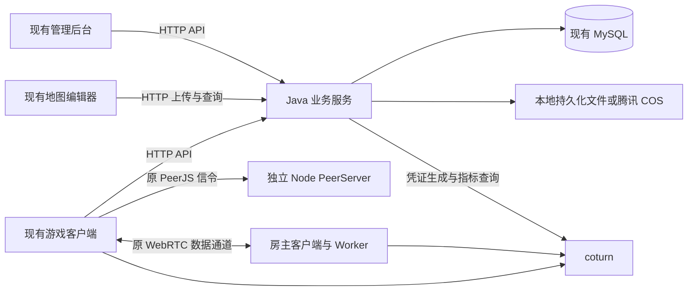

# Java 服务端迁移任务

评估日期：2026 年 10 月 10 日。源码基线：`61976ab6c020f77b14914cb0604afd49bf58b484`。任务状态：**评估完成，实施未开始**。

本轮目标是将 `apps/server` 的业务服务迁移到 Java，继续支持现有游戏客户端、管理后台和地图编辑器。**Unity 独立客户端任务待定，不纳入本轮排期。** 此前讨论的 Java 对局消息转发方案 C、服务端权威规则、移动端离线续局，也不属于此次服务端语言迁移。

建议先在 `apps/server-java` 建立并行工程，完成接口和数据验证后再替换线上业务 API。保留 PeerJS 客户端，将原进程内的 PeerServer 拆为独立 Node 服务，继续使用 coturn。这次迁移可以减少业务后端对 Node 的依赖，但不会让整个项目完全脱离 Node。

## 文档导航

| 文档 | 用途 |
| --- | --- |
| [逐文件迁移清单](file-migration-plan.md) | 对照全部 47 个服务端文件分配实施任务，包含拟新增 Java 文件和验收项 |
| [接口与客户端兼容清单](api-compatibility.md) | 39 个业务接口、鉴权、加密、上传格式及少量前端配套改动 |
| [数据部署与切换方案](data-and-deployment.md) | 数据表、配置、PeerServer 拆分、文件搬迁、发布和回滚 |
| [原技术栈评估](../technical-assessment.md) | 项目总体背景 |
| [原方案 C 评估](../java-websocket-relay-assessment.md) | 独立的对局消息转发提案，不计入本轮 |
| [Unity 架构评估](../unity-platform-architecture-assessment.md) | 暂存未来需求，任务待定 |

## 1 迁移边界

| 本轮交付 | 本轮不交付 |
| --- | --- |
| 账号、登录、刷新令牌、权限与在线状态 | Unity 工程、移动端 UI 或商店发布 |
| 管理用户、创作者配额、API Key、审计 | 玩家输入、回合推进、掷骰、胜负结算的服务端执行 |
| 地图上传、审核、发布、上下架、文件清理 | Java WebSocket 对局转发、PeerJS 协议的 Java 重写 |
| 房间发现、房主租约、心跳、房间状态 | 服务器替代房主 Worker，保存和恢复完整对局 |
| 统计、coturn 指标代理、TURN 临时凭证 | 新地图格式、玩法脚本升级或规则迁移 |
| Java 构建部署、数据兼容、客户端必要修正 | 多地域、无损热迁移、集群高可用或自动扩缩容 |

现有 `room-router` 管的是房间登记信息，不保存棋盘、玩家资产或回合状态。将它改为 Java 后，**房主退出仍可能导致对局中断**；这一限制要到未来权威对局项目中解决。



图中 Java 到 coturn 的凭证生成表示共享密钥计算，不是逐次调用 coturn 签发凭证；只有指标查询是 HTTP 请求。PeerServer 不转发实际游戏数据。[PeerServer 官方说明](https://github.com/peers/peerjs-server)

## 2 源码规模与评估结论

| 项目 | 本次盘点 |
| --- | --- |
| `apps/server` 已跟踪文件 | 47 个，其中 42 个 TypeScript 文件，合计 3,933 行 TS 源码 |
| 业务路由 | 39 个：用户 14、地图 12、房间 10、统计 2、coturn 1 |
| 原数据库实体 | 5 个：User、GameMap、GameRecord、MapKey、AdminAuditLog |
| 额外服务入口 | `/health`、`/static/**`、管理后台 `/env.js` 与 SPA、PeerServer |
| 高工作量部分 | 加密和令牌兼容、上传与审核事务、房间并发状态、存量数据及文件切换 |
| 无须逐行翻译的部分 | 未接入主入口的旧 WebSocket RoomRouter、旧任务队列、自调用 HTTP 工具和部分旧类型 |

文件数量不等于 Java 类数量。路由应拆成 Controller、Service、Repository 和 DTO；废弃实现则不迁移。详细去向以逐文件清单为准，不能只重写五个 Router 就认为迁移完成。

## 3 建议技术栈与工程形态

| 领域 | 建议 | 选择理由 |
| --- | --- | --- |
| Java 与构建 | Java 21、Maven Wrapper | 采用固定工具链，便于本机、CI 和容器一致构建 |
| 应用框架 | Spring Boot 4.1.x、Spring MVC | 以已有 HTTP CRUD 和上传为主，无需同时引入响应式模型 |
| 鉴权 | Spring Security、RS256 JWT、独立 API Key 与房主租约校验 | 保留三种身份凭证的语义，不能把所有房间请求强制改成用户登录 |
| 数据访问 | Spring JDBC / JdbcClient、MySQL Connector、HikariCP | 显式保留原表、复合主键和查询行为，避免 ORM 自动改表 |
| 数据版本 | Flyway | 记录一次性数据修正，关闭运行时自动同步结构 |
| 文件 | StorageProvider 接口、本地实现、腾讯 COS Java SDK | 保留存量文件 URL 和双存储能力 |
| 观测 | SLF4J / Logback、内部 readiness 与指标 | 日志移出公开文件目录，启动失败可被部署系统发现 |
| 验证 | JUnit、MockMvc、Testcontainers MySQL、Node/Java 契约样例 | 覆盖跨语言加密、真实 MySQL 行为与现有端调用 |

评估时 Spring Boot 官方文档显示 4.1.1 支持 Java 17–26，因此 Java 21 位于兼容范围。实施时锁定具体补丁版本，以 Boot BOM 管理 Spring 组件，先验证 COS SDK 和测试依赖；本文件不要求盲目追随最新版本。[Spring Boot 系统要求](https://docs.spring.io/spring-boot/system-requirements.html)

JWT 解码能力可用 Spring Security，但现有客户端还发送不带 `Bearer` 的 Authorization，需要自定义提取兼容；不要额外引入本项目并不存在的 OAuth 登录中心。[Spring Security JWT](https://docs.spring.io/spring-security/reference/servlet/oauth2/resource-server/jwt.html) 数据访问和 COS 的候选实现分别参考 [Spring JDBC](https://docs.spring.io/spring-framework/reference/data-access/jdbc/core.html)、[腾讯 COS Java SDK](https://github.com/tencentyun/cos-java-sdk-v5)。

拟建目录如下，当前仅为实施设计：

```text
apps/server-java/
  pom.xml
  mvnw / mvnw.cmd / .mvn/wrapper/
  src/main/java/com/minemonopoly/server/
    ServerApplication.java
    config/          # 类型化配置、Web、安全、调度、数据源
    common/          # 返回结构、异常映射、时钟、ID
    security/        # JWT、登录密码解密、API Key
    user/            # 用户与创作者管理
    map/             # 地图上传、审核、查询
    room/            # 房间目录、租约、TURN 凭证
    storage/         # 文件验证、存储、补偿清理
    statistics/      # 统计与 coturn 指标
    audit/           # 管理员审计
  src/main/resources/
    application.yml
    logback-spring.xml
    db/migration/
  src/test/          # 契约、集成与并发验证
```

管理后台静态资源建议交给独立 Nginx 服务，保留原外部访问地址和动态配置注入。业务 Java 服务不再同时启动一个 Node 信令服务和第二个后台 HTTP 监听器。

## 4 实施任务与依赖

所有复选框都是待办。人日按熟悉 Java、TypeScript 和现有项目的开发者估算，每人日约 8 小时；包含自测与必要前端适配，不含组织审批等待。

| 阶段 | 待办任务 | 对应文件清单 | 交付与退出条件 | 人日 |
| --- | --- | --- | --- | --- |
| P0 | [ ] 冻结接口样例、数据库 DDL 和配置基线；确认兼容修正 | F03、F13–F18、F23–F27 | 39 个接口的正常与失败样例、实际 DDL、脱敏数据集、切换策略 | 2–3 |
| P1 | [ ] 建 Java 工程、配置、异常返回、安全骨架和 CI | F01–F04、F06、F22、F32、F46–F47 | 空服务可构建部署；健康检查和错误结构确定 | 1–2 |
| P2 | [ ] 实现原五张表的数据访问和一次性迁移 | F07–F18 | 旧数据读写一致；无自动 DDL；事务与回滚演练通过 | 2–3 |
| P3 | [ ] 迁密码、JWT、角色、限流并修正客户端时间和密钥缓存 | F27–F28、F31、F34–F35、F44 | 原账号可登录；令牌到期正确；访问、刷新、管理员权限分离 | 3–5 |
| P4 | [ ] 迁用户管理、创作者限制、API Key 和审计 | F07、F10–F12、F27–F28、F33 | 管理后台用户全流程及删除联动通过 | 2–3 |
| P5 | [ ] 迁本地/COS 文件、multipart、校验与补偿 | F36–F43 | 两种存储全流程；部分上传失败和 DB 失败的新文件可追踪回收 | 3–5 |
| P6 | [ ] 迁地图上传、审核、上下架和查询 | F08、F14、F24 | 编辑器投稿到客户端下载形成闭环，旧地图可继续使用 | 4–6 |
| P7 | [ ] 迁房间状态机、租约、TURN；拆独立 PeerServer | F03、F09、F25、F45 | 并发租约验证、原客户端联机、TURN 中继实测通过 | 2–4 |
| P8 | [ ] 迁用户/房间统计与 coturn 指标 | F23、F26、F32 | 同一数据集统计一致，指标超时行为正确 | 1–2 |
| P9 | [ ] 部署联调、回归、容量验证、文件搬迁和回滚演练 | 全部，外部文件见兼容清单 | 三端业务验收、Peer 兼容、备份恢复与发布清单签收 | 4–5 |
| 合计 | 基础迁移与必要兼容修正 | — | 单实例 Java 业务服务可替换 Node API | **24–38 人日** |

再预留约 25% 联调与存量数据差异缓冲，排期采用 **30–48 人日**。单人全职约 **6–10 周**；两人可分担存储/地图与账号/房间，但需共享契约和集成窗口，不能简单将日历时间除以二。该估算来自静态代码盘点，P0 完成后应重新估算。

依赖顺序：P0 → P1/P2 → P3/P4；P5 完成后进入 P6；P7 依赖鉴权和数据访问；P8 依赖数据口径确认；P9 汇总所有阶段。文件任务与阶段任务是同一工作在两个维度的索引，**不能重复相加工时**。

此前粗略的 HTTP 迁移估算未逐项展开上传失败补偿、令牌时间修正、前端配套与实际文件卷搬迁；本表是针对当前完整业务范围的细化估算。方案 C、Unity 的历史估算不应合并进本表。

## 5 开发前需要确定的实现决策

下列是建议默认值和变更影响，留在 P0 技术评审中定稿，不阻碍现在完成任务拆解。

| 编号 | 建议默认值 | 对实施的影响 |
| --- | --- | --- |
| D1 认证切换 | 新 Java 使用固定持久化签名密钥、标准秒级 JWT；发布时要求重新登录 | 现 Node 密钥在内存中每次启动生成，不能假定 Java 能验证旧令牌；客户端和后台要同期支持秒级 `exp` |
| D2 房间目录 | 基础版维持单实例内存目录；停开新房并排空后切换 | 不承诺 API 重启后保留房间登记；不存在记录的 reclaim 返回 410，不延续原来的无凭证重建行为；客户端提供重新创建房间入口 |
| D3 可恢复目录 | 若本轮必须支持 Java 重启后的租约恢复，增加持久化房间目录，预计另加 2–4 人日 | 只恢复发现和租约，不恢复对局规则；详见数据文档的可选任务，不含在 24–38 人日中 |
| D4 兼容修正 | 采用接口文档 C01–C08 的明确修正 | 包括令牌类型、敏感返回字段、房主写接口校验和公开文件范围；必须随前端发布验证 |
| D5 存储与地址 | 保留现行本地/COS 模式、旧 URL 和公开域名 | 不同时改域名、迁所有对象或升级地图格式，减少不可归因的差异 |
| D6 数据库 | 沿用现有库和五张表，按真实 DDL 编写显式 SQL | 先不整理复合主键，不批量重置账号、API Key、地图密钥或 UUID |

若要求完全不改客户端，可另评估临时兼容层，但继续签发毫秒级过期 JWT、公开返回密码字段、允许任意改房间状态不应成为 Java 正式版验收目标。当前计划包含少量明确列出的前端配套改动。

## 6 优先验证的难点

| 难点 | 源码现状 | 对工作量的影响 |
| --- | --- | --- |
| 旧密码可登录 | AES-GCM 请求加密，数据库 HMAC-SHA512，salt 按 UTF-8 使用 | 先做跨语言向量，不能直接换成 BCrypt 后宣布兼容 |
| JWT 时间单位 | Node 把毫秒写进标准要求秒的 `exp`，两端也按毫秒比较 | 必须联动令牌签发和两端刷新逻辑 |
| 数据结构 | User 与 GameRecord 含复合主键，TypeORM 自动同步 | 不能按常见单主键实体假设建表 |
| 上传和审核 | 多文件上传、动态大小限制、旧文件保留、审核替换 | 存储操作不受数据库事务保护，需要明确补偿与清理重试 |
| 房间并发 | 原逻辑依赖单个 Node 事件循环与内存 Map | Java 多请求线程和调度线程必须实现同房间原子状态更新 |
| 文件卷 | Docker 运行目录与现卷挂载路径不一致 | 要核对容器实际文件，不能只复制命名卷 |

## 7 完成标准

- [ ] 逐文件清单 F01–F47 都有“已迁移、已替代或确认不迁移”的记录及对应提交。
- [ ] 39 个业务接口全部完成契约验证；C01–C08 差异有前端适配及验收记录。
- [ ] 游戏客户端、管理后台、地图编辑器均完成核心流程验收；PeerJS 直连和需要 TURN 的网络均可联机。
- [ ] 存量账号、API Key、地图、审核候选文件、历史统计都能继续使用；不暴露密码哈希、salt、租约或日志文件。
- [ ] JWT、地图、上传、房间并发及故障补偿的必要测试通过；容量目标由现网测量确定，无虚构并发承诺。
- [ ] 发布演练验证真实文件位置、备份恢复、排空房间、重新登录和回滚；Node 旧服务保留到观察期结束。
- [ ] 交付 Java 部署说明、环境变量表、运维检查项与已知限制；Unity 和方案 C 仍保持独立待办。

实施记录建议在每个阶段完成时补充“负责人、提交、测试证据、实际人日、剩余差异”。目前所有实现均待开始。
