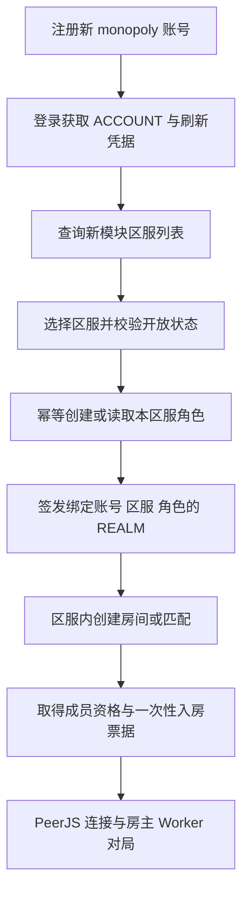

# GameBackend monopoly 模块迁移升级方案

更新日期：2026 年 10 月 10 日。状态：方案已编写，业务代码、建表迁移和部署尚未实施。

本轮在 `/Users/micy/games/GameBackend/modules/monopoly` 新建独立业务模块，承接 mine-monopoly 的账号、地图、房间发现、匹配、管理和统计能力。用户先注册登录，再选择区服，最后在所选区服内匹配游戏。游戏端、管理后台和地图编辑器同步升级协议。

**已确认从全新数据开始：重新注册账号、配置区服、发布地图，不导入旧 Node 数据。** 新模块不与 GameBackend 现有 system、game、classic 业务共享账号、区服、角色、地图、房间或业务记录。本轮是业务升级重建，不再以旧接口和旧数据库原样兼容为交付目标。

本文是新的实施依据。原 [F01 至 F47 清单](file-migration-plan.md)保留为源文件职责索引；原 [接口兼容清单](api-compatibility.md)保留为旧行为参考。两者与本文冲突时，以本文为准。本文中的目录、表、类和接口均为拟新增或拟调整设计，不表示已经存在。

## 一 已确认决策与旧方案替换关系

| 事项 | 新决策 | 被替换的旧约定 |
| --- | --- | --- |
| 工程 | 新增 GameBackend 的 `modules/monopoly`，由现有 start 服务装配 | 不再建立独立 `apps/server-java` 服务工程 |
| 技术栈 | 沿用仓库 Java 17、Spring Boot 3.5.14、Maven 和 MyBatis-Plus | 不因迁移升级整库至 Java 21、Boot 4，也不采用旧方案的 JDBC Repository |
| 数据 | 全部新建表，统一 `monopoly_mine_` 前缀、自增 Long 主键 | 不沿用旧五表、UUID 或复合主键，不建立旧 ID 映射 |
| 初始数据 | 新账号、新区服、新角色、新地图和新 Key | 不导入旧密码、账号、Key、地图、文件、审计和历史记录 |
| 登录 | ACCOUNT 平台账号身份和 REALM 区服角色身份 | 不再保留旧 RS256 access／refresh JWT、裸 Authorization 和游客开房 |
| HTTP | 统一 GameBackend `Result`；三端升级 | 不保留 `status/msg/data`、裸 roomId 和心跳空响应契约 |
| 业务 | monopoly 自己的 Service、Mapper、状态机和授权 | 不调用现有 GameTokenService、ClassicRoomService 或地图发布服务 |
| 存储 | 新对象目录与归属记录，升级流式上传和补偿清理 | 不把旧文件服务的当前行为直接当作迁移完成 |

新建表仍满足用户要求的 `monopoly_` 前缀。采用更具体的 `monopoly_mine_`，是因为当前数据库迁移中已经存在 `monopoly_room`、`monopoly_room_player`、`monopoly_map_project`、`monopoly_classic_room` 等表；这些表全部属于原业务，不能被新模块复用或覆盖。

## 二 业务边界和基础设施复用

允许复用 Spring MVC、Spring Security 过滤框架、MyBatis-Plus、事务设施、数据库连接池、Redis 客户端、Java 加密库、COS SDK、日志和构建设施。允许同一个 MySQL 实例和业务 schema 承载新旧表；逻辑隔离不要求另起一个数据库。

新模块运行时只访问自己的业务表，不跨旧表关联、不借用旧 Service 查询、不进行双写同步。账号、管理员权限、区服生命周期、文件归属和审计都由新模块管理。Flyway 版本历史等技术元数据可以由宿主应用统一维护。

复用文件或日志基础组件时，也要核对其隐含依赖：不得经由 `CloudConfigProvider` 读取旧业务配置表作为新模块配置，不得把新模块的管理审计写到旧业务审计表。新配置来自规定的三个 application YAML；技术日志优先输出标准日志。框架 `ErrorLogRpc` 若会为新路由写旧业务表，应增加按模块排除或独立落地机制。

本轮继续沿用 PeerJS、独立 Node PeerServer 和 coturn。对局规则仍由客户端房主及 Worker 执行；新增的 Java 匹配、成员和租约逻辑不执行掷骰、资产结算或胜负裁决。使用全新业务逻辑不等于接入 GameBackend 的现有权威对局引擎。Unity、服务端权威规则、离线继续对局和多实例高可用另行立项。

区服在首版是逻辑隔离单元，由同一 Java API 实例承载。选择区服获得受约束的角色身份，不代表为每个区服启动独立 JVM；后续物理分服需要增加路由与运维设计。

## 三 模块组织和宿主接入

```text
GameBackend/
  modules/
    monopoly/
      README.md
      pom.xml                         # 聚合 monopoly-biz
      monopoly-biz/
        pom.xml
        src/main/java/cn/cloud/monopoly/
          config/                     # 配置、任务、安全接入
          constant/                   # 错误码和状态
          controller/                 # auth、realm、creator、map、room、admin
          security/                   # ACCOUNT、REALM、API Key、上下文
          service/                    # 业务接口
          serviceImpl/                # 事务和业务实现
          mapper/                     # BaseMapper 接口
          model/entity/               # 只映射 monopoly_mine_ 表
          model/dto/
          model/vo/
          storage/                    # 流式存储、对象归属、补偿
          job/                        # 房间到期、在线状态、清理任务
        src/main/resources/mapper/monopoly/
        src/test/java/cn/cloud/monopoly/
    start/src/main/resources/
      application.yml
      application-sit.yml
      application-prod.yml
      db/migration/V{next}__monopoly_mine_*.sql
```

不额外创建 monopoly 应用入口或部署 profile。`monopoly-biz` 不依赖 `game-biz`、`game-status` 或 `system-biz`；业务接口与实现可以参考现有写法，不能通过继承旧业务 Service 间接访问旧表。

| 已有文件或配置 | 必要调整 |
| --- | --- |
| `GameBackend/modules/pom.xml` | 注册 monopoly 聚合模块，管理 monopoly-biz 版本 |
| `GameBackend/modules/start/pom.xml` | 增加 monopoly-biz 依赖 |
| `CloudStartApplication.java` | 显式扫描或导入 `cn.cloud.monopoly`；当前只扫描 system 和 game |
| `ApiConstants.java` | 新增 `MONOPOLY_PREFIX = /monopoly-api` |
| `RpcJwtAuthenticationController.java` | `supports` 排除 `/monopoly-api`，避免 system 认证兜底抢占新域 |
| 三个 application YAML | 添加 `monopoly.mine.*` 配置，调整上传边界及精确公开路由 |
| 文件／异常基础设施 | 只做支持新模块所必需的扩展，并回归既有调用方 |
| 反代和 CI | 新增 API 路由、Peer 转发、文件目录、上传限制和模块测试 |

新持久化 Service 实现继承 `ServiceImpl<Mapper, Entity>`，Mapper 继承 `BaseMapper<Entity>`；新增 Mapper 同样不写手工 INSERT、UPDATE、DELETE。实体在 ServiceImpl 中赋值，通过 MyBatis-Plus 持久化。复合业务约束使用唯一索引；计数等并发更新使用完整条件的更新或事务行锁，不把外部网络上传放进长事务。

## 四 全新数据模型

以下为首版建议表结构边界，字段长度和完整 DDL 在实施阶段冻结。每张表均使用 `id BIGINT UNSIGNED NOT NULL AUTO_INCREMENT` 主键，Java 为 `@TableId(type = IdType.AUTO) Long id`。内部 ID 与用户可见房间码、会话随机值分开，API 中各类 ID 统一以十进制字符串传递。

| 新表 | 职责与关键约束 |
| --- | --- |
| `monopoly_mine_account` | 平台账号、密码哈希、昵称、头像、状态、管理员／创作者标志、配额和上传限制；规范化账号唯一 |
| `monopoly_mine_account_session` | ACCOUNT 会话、刷新凭据哈希、访问与刷新有效期、撤销状态；session_id 唯一 |
| `monopoly_mine_server` | 独立区服目录，server_code 唯一；开放、维护、关闭状态及新角色容量 |
| `monopoly_mine_role` | 账号在区服内的角色、昵称、状态和活跃时间；`(server_id, account_id)` 唯一 |
| `monopoly_mine_realm_session` | 绑定 account_session、account_id、server_id、role_id 的 REALM 会话；session_id 唯一 |
| `monopoly_mine_map` | 正式与候选地图、源文件、封面、hash、作者、审核状态、发布次数、内容版本和 changelog |
| `monopoly_mine_map_key` | 创作者 API Key、吊销时间；account_id 与 key 分别唯一，均只关联新账号 |
| `monopoly_mine_map_upload_daily` | 日上传计数；`(account_id, business_date)` 唯一；失败不增加计数 |
| `monopoly_mine_server_map` | 区服可用地图集合；`(server_id, map_id)` 唯一，绑定启用后仍须检查地图发布状态 |
| `monopoly_mine_room` | 持久化房间目录、区服、房主角色、peerId、租约哈希、epoch、状态和时间；room_session_id 唯一 |
| `monopoly_mine_room_member` | 房间成员、席位、占位期限、活跃时间和进入／离开状态；房间会话内角色唯一，限制同区服角色同时占用一个活跃房间 |
| `monopoly_mine_room_ticket` | 单次 Peer 入房凭据哈希、房间会话、epoch、角色、peerId、过期和消费时间 |
| `monopoly_mine_game_record` | 房间历史记录、区服、地图快照和毫秒时长；room_session_id 唯一，防止重复扫描记账 |
| `monopoly_mine_admin_audit_log` | 新域管理员操作、目标、动作、脱敏明细；删除账号不级联删除历史审计 |
| `monopoly_mine_upload_operation` | 上传操作计划、关联业务、阶段和超时，用于恢复 DB 提交前的中断操作 |
| `monopoly_mine_storage_object` | provider、object_key、URL、上传操作、文件角色和引用状态；`(provider, object_key)` 唯一 |
| `monopoly_mine_storage_cleanup_task` | 待删对象、原因、重试次数、退避时间和结果；同一对象的待清理任务幂等 |

全部关联只指向上述新表。账号、创作者和地图库是新模块的平台级能力；角色、匹配、房间、成员和房间历史是区服级能力。地图由新模块管理员发布并绑定到目标区服，不能因全局已发布就自动在所有区服可匹配。

玩家进入区服后的业务查询从 REALM 身份取得 server_id；请求中若携带区服 ID，必须与身份相符。ACCOUNT 的区服选择接口和管理员跨区服管理接口另按其权限验证目标区服。行锁、缓存、幂等键和任务扫描都包含区服或全局唯一房间会话标识。UTC 保存业务时刻，统计与上传日界线按显式业务时区计算；接口时刻统一毫秒时间戳，JWT 时间例外使用秒。

房间码在区服内唯一占用，可采用 `(server_id, room_code, active_slot)` 唯一索引：占用时 active_slot=1，保留期结束后置 NULL。关闭后至少保留五分钟 tombstone；即使房间码被再次使用，新房也必须有新 room_session_id，旧租约不能操作新房。

Flyway 继续由 GameBackend 的现有 schema 和版本历史管理，只追加创建新表的迁移，不改写已执行版本，不对旧 Node 库执行迁移。仓库当前最高迁移文件为 V48，实施时重新检查版本占用再分配，不预先占用 V49。禁止因本模块而初始化或修改既有 `user`、`game_*`、`monopoly_*` 旧业务表。

## 五 按账号和区服重新设计鉴权

### 登录和选服流程



原判断“现有鉴权不能直接接住旧客户端”的前提已经改变：三端升级后，不再需要保留旧认证协议。**ACCOUNT／REALM 分层符合新游戏流程，可以复用统一 Bearer 过滤器和认证扩展接口；现有 GameTokenService 的业务实现仍不能直接复用，因为它写入 game 会话表并调用旧区服服务。**

| 身份或凭据 | 适用范围 | 校验要求 |
| --- | --- | --- |
| 匿名 | 注册、登录、刷新入口、最小健康检查、预检和明确公开的静态资源 | 刷新入口用刷新凭据自身认证，公开不等于允许空刷新 |
| ACCOUNT | 账号资料、区服列表、进入区服、账号退出 | 新账号有效、账号会话有效、tokenType=ACCOUNT |
| ACCOUNT 加管理员权限 | 用户、区服、地图审核、绑定、统计、Key 和运维管理 | 每次读取新账号当前权限，不能只相信签发时的 isAdmin |
| REALM | 区服地图目录、创建／加入／匹配、房间状态、TURN 和成员操作 | 校验账号会话、区服会话、角色归属和区服状态 |
| REALM 加房主租约 | 房主 ready、心跳、设置隐私／开始、关闭、恢复 | 同区服同房间会话、当前房主角色、epoch 和租约同时匹配 |
| X-Api-Key | 编辑器额度查询、自己的地图状态、投稿 | 新 Key 有效，新账号有效且仍是创作者；不授予账号或区服权限 |

未选区服的 ACCOUNT 不能匹配；REALM 不能当作管理员 token；旧 game/system/Node token 均不能用于新域。API Key 继续服务地图编辑器，不要求编辑器先进入区服。新管理员也是新模块账号，不使用 system 用户及旧权限表。

### Token 与密码实施方案

- 访问 JWT 使用 HS256，采用新模块自己的持久化签名密钥、issuer 和 audience。复用 Nimbus/JCA 库，不复用 game 的签名密钥或会话缓存。算法固定校验，并校验 issuer、audience、tokenType、iat、nbf、exp 和会话撤销状态。
- ACCOUNT 包含 accountId、sessionId；REALM 额外包含 accountSessionId、serverId、roleId。ID 对外按字符串处理，JWT 时间为秒。上下文使用独立 `MonopolyAccountPrincipal`、`MonopolyRealmPrincipal` 和 `MonopolySecurityUtils`。
- 设计初始有效期为 ACCOUNT 两小时、REALM 一小时、账号刷新凭据七天，集中配置。刷新凭据使用安全随机数、服务端只保存哈希，与访问 JWT 分离。刷新时以事务比较并轮换哈希；旧凭据重放失败，客户端并发刷新合并为一次。
- 刷新账号访问凭证不改变其账号会话身份，也不自动创建或切换角色。REALM 到期后由 ACCOUNT 重新进入原区服，幂等读取角色；账号退出、封禁和密码重置撤销关联会话。首版以数据库会话状态为准，Redis 只承担限流等辅助功能，避免缓存命中绕过已撤销会话。
- 新密码使用 BCrypt，TLS 传输。由于全新注册，不迁移旧 HMAC-SHA512 或 salt，不实现旧登录 AES 密钥接口；客户端和后台同步移除旧加密密钥缓存与预加密调用。密码、token 和 Key 不进入请求日志。
- 注册保持账号规则和头像需求，显式校验空白、长度及 BCrypt 有效输入字节边界，禁止静默截断；普通注册永不自动授予管理员。初始管理员通过受控初始化流程显式建立，不把“第一个注册者”设为管理员。
- 登录限流初值为每分钟十次，注册每小时五次；使用受信代理解析后的 IP，并按账号补充防重试策略。账号在线写入节流三十秒，每两分钟扫描不活跃账号；角色在线与房间成员在线分别记录，不以账号在线推断正在对局。

同一账号可在不同区服分别持有角色，首版客户端每次只选择一个活跃区服。切服前退出本端旧房间、撤销本端旧 REALM 并清理本端上下文；退出 ACCOUNT 撤销该账号会话派生的全部 REALM，不强制下线其他独立设备会话，封禁则撤销账号全部会话。

### 统一过滤器接入

新增 `MonopolyJwtAuthenticationHandler implements JwtAuthenticationRpc`，只支持 `/monopoly-api/**`。按方法和路由选择 ACCOUNT 或 REALM，不以是否出现 serverId 参数猜测身份级别。

现有 `RpcJwtAuthenticationController.supports` 接管所有非 `/game-api` 请求，需要显式排除新前缀；仅依赖 Bean 顺序不可靠。通过集成测试确认每条受保护请求恰好被一个认证域处理。

注册、登录、刷新和健康检查以精确路径加入两套环境配置的 JWT 白名单。API Key 的精确编辑器路由也绕过用户 JWT，但必须先由 `MonopolyMapKeyFilter` 按方法和路径认证；其创作者主体保存在受控 request attribute，由编辑器控制器强制取得，避免共享 JWT 白名单分支将 SecurityContext 设为匿名后丢失 Key 身份。没有 Key 过滤器或未匹配到受支持操作时拒绝请求。

Key 过滤器要先于 multipart 解析执行。核对 Servlet 自动注册和 Security 链注册，保证每个过滤器只执行一次。不能把整个 `/monopoly-api/**` 设为匿名，也不能用 Controller 中检查文件大小替代前置认证。

## 六 Result 与异常约定

业务 JSON 直接使用 `cn.cloud.framework.common.utils.Result`，核心字段为 `code`、`msg`、`data`。成功由 `code == 200` 判断；实际序列化的其他派生字段以契约样例固定，客户端不得依赖“仅有三个字段”。所有分页、心跳、随机房间、管理员查询也使用 Result，不再维持旧裸对象或空响应。

采用宿主现有异常语义：业务 `ServiceException` 和当前安全入口可能返回 HTTP 200 加非成功 Result.code；参数校验、multipart 超限和未知异常仍可能返回 HTTP 400、413、500。三端同时处理 HTTP 错误与 Result 业务错误，不能只在 Axios 的 HTTP 401 分支刷新登录。

新增 `MonopolyErrorCodes` 区分 ACCOUNT 失效、REALM 失效、权限不足、区服维护、房间满员、租约冲突、房间过期、审核冲突和上传限制。数值在 U0 接口基线中统一登记。认证失败接入框架可携带错误码的认证异常；业务失败使用 ServiceException，不将可预期错误全部抛成 IllegalArgumentException 后落入 500。

无需为旧 status 格式新增全局异常处理器，也不为了 monopoly 改变旧接口的 HTTP 状态约定。流式上传在进入 MVC 前产生的错误仍须使用 Result 输出，并在契约测试中覆盖。代理自身生成的非 JSON 413／502 由客户端转换为可读提示。

`Result.data(null)` 当前会变为空数组，不能用它表达业务 null。无数据操作使用 `Result.ok()`；随机匹配等返回明确 VO，例如 `matched=false`，不依赖空字符串、空数组和 null 相互替代。ID 为字符串、布尔为布尔、统计为数值；列表保留 page=1、size=8 的默认值，统一返回 total/current/size/records。

最小健康检查返回 Result，存活检查与内部依赖就绪检查分开；文件下载、静态文件和 PeerServer 协议不强行包装为 JSON。

## 七 原有业务接口的升级映射

下表沿用原清单的 39 个接口编号。新路径均位于 `/monopoly-api` 下，前缀不在各行重复书写。“管理员”表示新域 ACCOUNT 加管理员权限，“创作者”表示 X-Api-Key。路径是新协议，不提供旧路径长期兼容代理。

| 原编号与接口 | 新方法与路径 | 身份和主要变化 |
| --- | --- | --- |
| U01 GET user/is-admin | GET `/admin/me` | 管理员；返回新域权限 |
| U02 GET user/list | GET `/admin/accounts` | 管理员；查询新账号、创作者和上传额度 |
| U03 POST user/key | POST `/admin/accounts/{id}/map-key` | 管理员；生成新 Key |
| U04 POST user/key/reset | POST `/admin/accounts/{id}/map-key/reset` | 管理员；仅有效创作者可重置 |
| U05 POST user/key/revoke | POST `/admin/accounts/{id}/map-key/revoke` | 管理员；吊销并审计 |
| U06 POST user/key/reset-upload-count | POST `/admin/accounts/{id}/upload-count/reset` | 管理员；重置当前业务日计数 |
| U07 GET user/info | GET `/account/me` | ACCOUNT；返回新账号安全资料 |
| U08 GET user/encryption-key | 退役 | 新登录使用 TLS；删除两端调用与缓存 |
| U09 POST user/create | POST `/admin/accounts` | 管理员；新账号，BCrypt 密码 |
| U10 POST user/update | PATCH `/admin/accounts/{id}` | 管理员；省略、null、false 分别处理 |
| U11 DELETE user/delete | DELETE `/admin/accounts/{id}` | 管理员；撤销会话和 Key，处理新地图归属 |
| U12 POST user/login | POST `/auth/login` | 匿名入口；返回 ACCOUNT 与刷新凭据 |
| U13 POST user/refresh-token | POST `/auth/refresh` | 刷新凭据自身认证；轮换，不接受旧 refresh JWT |
| U14 POST user/register | POST `/auth/register` | 匿名；multipart 头像和新账号密码；2 MiB 头像上限 |
| M01 GET game-map/key/info | GET `/creator/key/info` | 创作者；返回新配额、大小和日次数 |
| M02 GET game-map/status | GET `/creator/maps/{id}/status` | 创作者；仅本人地图 |
| M03 POST game-map/key/upload | POST `/creator/maps/upload` | 创作者；保留三个文件字段，统一 mapId 更新参数 |
| M04 POST game-map/review | POST `/admin/maps/{id}/review` | 管理员；approve/reject/offline/online/delete |
| M05 POST game-map/bind-creator | POST `/admin/maps/{id}/creator` | 管理员；只绑定新创作者 |
| M06 GET game-map/admin-list | GET `/admin/maps` | 管理员；分页、状态和创作者筛选 |
| M07 POST game-map/create | POST `/admin/maps` | 管理员；直接发布新地图 |
| M08 POST game-map/update | POST `/admin/maps/{id}/update` | 管理员；显式更新正式版本，不沿用旧隐式清空所有权行为 |
| M09 GET game-map/info | GET `/maps/{id}` | REALM；仅当前区服可用且已发布地图 |
| M10 GET game-map/list | GET `/maps` | REALM；当前区服地图目录 |
| M11 POST game-map/set-use | POST `/admin/servers/{serverId}/maps/{mapId}/availability` | 管理员；区服绑定启停取代全局 inuse |
| M12 DELETE game-map/delete | DELETE `/admin/maps/{id}` | 管理员；保护活跃房间引用，提交后清理 |
| R01 GET room-router/join | POST `/rooms/join` | REALM；在本区服按房间码创建或加入，使用幂等请求号 |
| R02 POST room-router/emit-host | POST `/rooms/{id}/host/ready` | REALM 加租约；房主身份由 token 推导 |
| R03 POST room-router/delete | POST `/rooms/{id}/close` | REALM 加租约；Result；不再依赖无认证 sendBeacon |
| R04 POST room-router/reclaim-host | POST `/rooms/{id}/host/reclaim` | REALM 加旧租约；仅 grace 恢复，终态引导新建 |
| R05 GET room-router/status | GET `/rooms/{id}/status` | REALM；本区服成员可查完整状态 |
| R06 GET room-router/heart | POST `/rooms/{id}/heartbeats` | REALM 加租约；返回 Result |
| R07 GET room-router/room-list | GET `/admin/rooms` | 管理员；可按新域区服过滤，隐藏租约和票据 |
| R08 GET room-router/random-public-room | POST `/rooms/match` | REALM；本区服原子占位，返回 matched 与房间信息 |
| R09 POST room-router/set-private | POST `/rooms/{id}/privacy` | REALM 加租约；核对房主角色 |
| R10 POST room-router/set-started | POST `/rooms/{id}/started` | REALM 加租约；核对区服地图和成员 |
| S01 GET statistics/users | GET `/admin/statistics/accounts` | 管理员；新账号统计和区服角色统计分开 |
| S02 GET statistics/games | GET `/admin/statistics/rooms` | 管理员；房间历史、时长和地图趋势 |
| T01 GET coturn/metrics | GET `/admin/coturn/metrics` | 管理员；同样解析上游指标并限制超时 |

需要新增的流程接口如下，不计入旧 39 项；最终接口总数以 U0 冻结清单为准。

| 方法与路径 | 用途 |
| --- | --- |
| GET `/servers` | ACCOUNT 查询新模块区服及本账号已有角色 |
| POST `/servers/{id}/enter` | ACCOUNT 进入区服，幂等建角色并签发 REALM |
| POST `/auth/logout` | 撤销当前 ACCOUNT 及派生 REALM |
| POST `/realm/logout` | 撤销当前 REALM，清理本角色房间成员关系 |
| GET/POST `/admin/servers` | 新区服查询和创建 |
| PATCH `/admin/servers/{id}` | 新区服维护、关闭、容量和开放规则 |
| POST `/rooms/{id}/leave` | 普通成员离房；房主离房执行房主关闭语义 |
| POST `/rooms/{id}/members/heartbeat` | REALM 成员更新本人的活跃时间，不允许代其他角色保活 |
| POST `/rooms/{id}/tickets` | REALM 成员取得短时、单次使用的 Peer 入房票据 |
| POST `/rooms/{id}/tickets/consume` | 房主凭 REALM 和租约校验实际连接 peerId 并消费票据 |
| GET `/health` | 最小匿名存活检查 |

新协议停止把 hostId、hostName 或 serverId 请求值当作身份证明；昵称可以展示，权限必须来自认证主体。分页和安全 DTO 不返回密码哈希、刷新哈希、租约、入房票据或内部路径。

## 八 新地图和区服房间业务

### 地图发布

地图保留 reviewing、published、rejected、offline 等明确状态，发布次数与内容版本分开。投稿使用 game-map、source-map、cover-image 字段，地图文件维持 fpmap/mmmap 原格式与字节，不解密重加密、不转换为旧 GameBackend 的规则文档。

每张地图分别维护已发布对象和待审核对象。审核通过在同一事务提升候选版本、递增发布次数、追加非空 changelog，并登记旧对象清理；拒绝记录理由，不能损坏已发布对象。管理员直接更新与创作者投稿分开实现，管理员更新只修改明确提供的业务字段，归属变更单独调用绑定接口。

创作者资格和额度属于新账号：取消资格时吊销 Key，清空相关额度配置；开启时默认地图额度 1。地图数包含全部状态，日上传次数首版保留软上限语义；成功次数原子累加，失败不增加。严格并发限额需要预占机制，不能把原子计数描述为严格限额。

删除账号前撤销身份和 Key；已发布地图保留并解绑作者账号，其余地图进入删除流程。活动房间仍引用的地图版本和对象暂不物理删除。地图下架或取消区服绑定禁止新开房，已建立房间按开房时冻结的版本继续运行。

### 区服匹配和房主租约

首版匹配在当前 server_id 内筛选 active、公开、未开始、房主 ready、地图可用且有空位的房间。通过事务锁定房间并写入成员，容量判断与占位原子完成；无匹配返回明确的 matched=false，由客户端选择创建房间。区服 A 不能查询、加入、修改或借用区服 B 的房间。

未完成连接的占位必须有超时，已入房成员单独维护心跳；超时、离房、撤销身份和房间终态都释放活跃占位并使未消费票据失效。成员租期及重连宽限在 U0 冻结，不能因客户端未成功连接而永久占满房间。维护状态停止新进服和新匹配，但允许已有成员完成心跳、离房和收尾；关闭区服前先排空或明确终止房间，不能通过拒绝所有请求造成无说明的对局中断。

采用新表持久化房间目录和租约，取代旧方案的纯内存默认值。这项扩展计入本轮房间任务，不承诺恢复完整游戏状态。基本时限仍采用心跳五秒、三十秒转 grace、grace 六十秒、终态保留五分钟、两秒扫描，统一由时钟和配置驱动。

房主租约只在签发／轮换时返回明文，数据库保存哈希。租约绑定区服、room_session_id、房主 roleId 和 epoch。grace 内有效心跳可恢复 active；主动 reclaim 在事务中验证旧租约并轮换。closed/expired 为终态，未知记录不凭 hostId 重建，客户端结束自动重试并引导新建房间。这是新协议的明确变化。

房间到期状态变更与历史记录写入在同一事务执行，以 room_session_id 唯一约束去重。历史记录沿用“房间过期记录”的业务口径，主动关闭不自动算作完成对局；duration 使用 BIGINT 毫秒。该统计不能作为权威胜负或资金结算依据。

Java 重启按保存的时间重算状态，不重置所有 TTL。目录仍有效时允许原房主在状态许可范围内恢复；过期则新建。房主浏览器退出仍可能中断对局，持久化租约不替代 Worker 状态恢复。

区服隔离还必须延伸到 Peer 数据连接。Java 返回 peerId 前先建立成员资格并签发短时票据；房主在接受游戏消息前，向 Java 消费票据，核对实际连接 peerId、房间会话、epoch 和成员角色。过期、跨区服、重放和不匹配票据拒绝，重连重新取票。不能仅靠 peerId 名称前缀保证权限。此机制约束正常客户端准入，不把可修改的房主程序提升为可信权威服务器。

TURN 凭据在通过 REALM 校验的房间加入／匹配响应中签发，HMAC-SHA1 的计算可复用底层工具；不接受客户端任意指定其他账号或区服身份。PeerServer 和 coturn 使用独立于旧业务的服务实例或明确隔离的路径／凭据配置；若同实例共享指标，后台必须标明统计为实例总量，不冒充新模块独占流量。

## 九 上传底座升级

存储配置和对象归属属于 monopoly。可共享 COS SDK 或连接管理代码，不共享旧文件记录、新旧对象 key 或目录扫描任务。新对象使用专属 `monopoly-mine/` 根目录，临时目录和日志目录在公开目录之外；清理只根据新模块对象计划和引用关系执行。

| 层次 | 首版设计 |
| --- | --- |
| 注册头像 | 单文件 2 MiB，按注册接口验证类型 |
| 创作者 | 默认每文件 50 MiB、每天 3 次；按账号配置读取，三个字段各最多一个 |
| 管理员 | 单独配置大小，不继承创作者额度；建议初值 100 MiB／文件 |
| 宿主硬上限 | 建议初值 100 MiB／文件、302 MiB／请求，为三个文件和表单开销留空间；动态额度不得高于硬上限 |
| 原有上传接口 | 保持既有有效边界；提高宿主总上限时，为非 monopoly 路由保留原 30MB／50MB 或其更严格的接口限制 |
| 限流与资源 | 限制并发上传、单用户请求、临时盘总量、上传时间和下游超时；实际阈值经 U4 负载验证冻结 |

以上为新系统的建议初值，不以未核实的历史文件尺寸决定边界。提高动态额度时必须同步校验代理、容器、逐路由和存储层上限。MB／MiB 在 UI、配置和响应中明确换算为字节。

1. 请求进入后先识别路由，认证账号或 API Key，确定动态策略。拒绝无效身份时不读取和暂存整份文件。
2. 使用经过验证的流式或延迟解析方案，按实际已读取字节执行逐文件和总量限制，不能只信 Content-Length。宿主默认 MultipartFile 全量解析之前的限制必须有端到端证据。
3. 创建 upload_operation，并在上传前登记各文件角色的对象计划；使用随机且独立的对象名，避免 game-map 与 source-map 同为 fpmap 时相互覆盖。
4. 本地使用受控临时文件和原子落盘／跨文件系统安全复制；COS 使用 InputStream、File 或有界分片上传。新链路禁止通过 `MultipartFile.getBytes()` 将整个大文件放入内存。
5. 每个对象成功后更新归属和状态；地图、计数、引用关系与旧对象清理任务在业务事务中提交。
6. 提交前失败只补偿本次新对象；提交后清理被替换且无引用的旧对象。网络操作不持有地图或账号的长事务锁。
7. 重启扫描未完成上传计划，核对业务引用后再删；即使 COS 成功后未及时写入成功标志，也能按预登记 key 查证。重复清理幂等，失败退避、记录脱敏原因并告警。

验收必须覆盖第二个文件失败、DB 提交失败、清理失败、连接中断、进程中断和重复任务；任何失败都不能删除仍被已发布地图或活动房间引用的资源。存储为 local/cos 显式模式，COS 部分配置缺失时启动失败。

## 十 原逐文件任务的重新归属

此表覆盖原 F01 至 F47。类名是实施建议；可以调整类拆分，但不得遗漏对应业务和测试。Java 包均位于 `cn.cloud.monopoly`，资源由新模块和 start 的既定职责分别承载。

| 原编号 | 新归属或处理 |
| --- | --- |
| F01 | 复用仓库忽略规则，补充新模块运行文件排除；无独立 server-java 目录 |
| F02 | monopoly 模块 README、本文、部署与前端升级说明 |
| F03 | 宿主装配、MonopolyProperties、健康检查、在线任务；Peer 和后台静态服务拆出 |
| F04 | monopoly 聚合 POM、monopoly-biz POM、宿主依赖和独立 Peer 包 |
| F05 | 旧 WebSocket RoomRouter 不迁移 |
| F06 | MonopolyProperties、MonopolyAuthProperties、MonopolyStorageProperties、MonopolyTurnProperties |
| F07 | MonopolyAdminAuditServiceImpl 与新审计实体／Mapper |
| F08 | MonopolyMapServiceImpl、MonopolyMapReviewServiceImpl、MonopolyServerMapServiceImpl |
| F09 | MonopolyGameRecordServiceImpl；房间到期事务和幂等记录 |
| F10 | MonopolyMapKeyServiceImpl；新 Key、资格检查、吊销与审计 |
| F11 | MonopolyMapUploadDailyServiceImpl；业务日和原子计数 |
| F12 | MonopolyAccountServiceImpl；新账号管理，不查询旧 User |
| F13 | 复用 MyBatis-Plus／连接池，追加新表 Flyway，无旧库 baseline |
| F14 | MonopolyMap 实体／Mapper、安全 VO；全新 Long 主键 |
| F15 | MonopolyGameRecord 实体／Mapper；BIGINT 毫秒，房间会话唯一 |
| F16 | MonopolyMapKey 实体／Mapper；只绑定新账号 |
| F17 | MonopolyAccount 实体及显式管理员初始化；不迁移旧密码 |
| F18 | MonopolyAdminAuditLog 实体；历史记录不随账号删除 |
| F19 | 只保留新 HTTP／领域状态需要的枚举 |
| F20 | 原游戏规则枚举不搬入服务端 |
| F21 | 新 ACCOUNT／REALM 主体、房间成员及 VO；不复制旧 User 类型 |
| F22 | 直接使用 Result、MonopolyErrorCodes 和宿主异常体系 |
| F23 | MonopolyCoturnMetricsController／Service；Result 和新管理员权限 |
| F24 | 新创作者／管理员／区服地图 Controller 和上传审核业务 |
| F25 | MonopolyRoomServiceImpl、成员准入、匹配、租约和到期任务；按区服隔离 |
| F26 | MonopolyStatisticsService；新账号、角色、房间口径 |
| F27 | 新账号／认证／管理 Controller；废弃旧登录加密接口 |
| F28 | MonopolyMapKeyFilter 和请求级 CreatorPrincipal |
| F29 | 旧 AsyncMissionQueue 不迁移，使用新房间事务边界 |
| F30 | 旧自调用 HTTP 工具不迁移 |
| F31 | 保留安全随机和必要工具；新密码 BCrypt，取消旧登录 AES／HMAC 协议 |
| F32 | 宿主日志与模块脱敏；不写公开文件根 |
| F33 | MonopolyCreatorUploadPolicy；独立处理配额、单文件和日次数 |
| F34 | MonopolyJwtAuthenticationHandler、SecurityUtils、在线状态任务 |
| F35 | 新模块 HS256 持久化密钥配置；不迁移旧内存 RSA／AES 密钥 |
| F36 | MonopolyCosStorageProvider；有界流式上传和对象级结果 |
| F37 | MonopolyStorageConfiguration；显式 local/cos 及组合配置校验 |
| F38 | 上传计划、对象归属、补偿 Service 与清理任务新表 |
| F39 | MonopolyUploadValidator／ObjectNamer；扩展名、路径和角色唯一命名 |
| F40 | MonopolyStorageService；统一编排 Provider 与补偿 |
| F41 | MonopolyLocalStorageProvider；新持久化根和受限公开映射 |
| F42 | 前置认证、动态限制、流式解析及原路由限制回归 |
| F43 | 新 StorageProvider、UploadSource、StoredObject 内部契约 |
| F44 | MonopolyTokenService；ACCOUNT／REALM、刷新凭据与新会话表 |
| F45 | MonopolyTurnCredentialService；从 REALM 主体签发凭据 |
| F46 | 沿用仓库 release=17 和 Java 17 测试，不创建第二套编译基线 |
| F47 | Maven 随现有 BOM；Peer 使用 pnpm 锁文件，旧 Node 服务依赖观察期后退役 |

新增的账号会话、区服、角色、地图区服绑定、成员、入房票据和管理员区服管理是原 47 项之外的工作，必须单独进入阶段任务。旧清单里的“保留 UUID／旧 Key／旧 URL／旧 token／原返回形态”不再作为验收条件。

## 十一 三端和部署配套

游戏端新增注册登录、区服选择、当前角色和切服流程；分别管理 ACCOUNT 与 REALM。所有业务 API 转到 `/monopoly-api`，拦截器解析 Result，并根据具体错误刷新账号、重新进服、返回选服页或结束房间恢复。刷新失败至多一次退出，不对所有业务错误自动重试。

后台改用新模块账号及管理员权限，增加区服创建／维护和地图区服绑定；用户、地图、Key、审计、统计和房间列表全部切到新域。旧 GameBackend 管理后台权限不能自然获得新域权限。

编辑器重新生成和配置新 Key，保留 multipart 的三个文件名及上传进度；更新 mapId、Result 和错误解析。旧 server-map-id、serverMapId、UUID 和旧 Key 不作兼容目标。新发布地图仍使用现有文件格式，作者和地图信息重新维护。

| 现有文件或目录 | 主要升级内容 |
| --- | --- |
| `apps/client/src/utils/api/index.ts`、`api/auth.ts`、`api/user.ts` | 新前缀、Bearer、两级身份、Result 和集中刷新 |
| `apps/client/src/utils/encryption.ts` | 移除旧登录 AES 密钥请求和缓存 |
| `apps/client/src/utils/api/room-router.ts`、`api/map.ts` | 选服后访问、房间新方法、成员和票据接口 |
| `apps/client/src/core/monopoly-host/MonopolyHost.ts`、`Room.ts` | 新租约、Result、终态恢复处理和房主操作 |
| `apps/client/src/core/network/WebRtcSessionManager.ts` | 入房票据校验、成员心跳、重连与切服清理 |
| `apps/client/src/views/room/components/online-room/online-room.vue` | 当前区服、房主权限和新房间操作入口 |
| 游戏端路由及新选服页面 | 新增区服列表、进入角色、维护状态提示和切服流程 |
| `apps/admin/src/utils/axios/index.ts`、`utils/auth.ts`、`utils/api/` | 新管理员登录、Result、区服和地图绑定操作 |
| `apps/map-editor/src/utils/map-upload.ts` | 新 Key、mapId、上传限制和错误解析 |
| `packages/types/interfaces/game/db.ts` 及实际引用的 API 类型 | 新 ID、账号／角色分离、区服和 Result VO；避免将实体当接口 DTO |
| `packages/env/`、后台 env.js 生成及部署配置 | 新公开 API／Peer 地址，清理旧入口，保留 secrets 白名单边界 |

游戏端房主关闭改为带 Bearer 的 fetch keepalive 等受控请求；sendBeacon 不能设置 Authorization，不能据此新增匿名关闭后门。页面关闭时的网络请求不保证送达，以心跳超时处理兜底。

Java 部署值只写现有 application.yml、application-sit.yml、application-prod.yml；禁止新建 application-monopoly.yml、后端 dotenv、外部配置导入或启动脚本业务覆盖。密钥材料使用受控资源／挂载，YAML 记录路径，不在示例或文档保存真实密钥。配置统一放 `monopoly.mine.*`，不挤占旧 `monopoly.classic.*`／`monopoly.runtime.*`。

sit/prod 的共享业务开关保持一致，沿用仓库当前 TEST 语义；prod 名称不自动使业务进入 PRODUCTION。网络、证书和受信代理按现有部署方式配置。新增反代覆盖 API、静态资源和 Peer Upgrade；浏览器 env.js 只注入公开参数。

新文件目录、COS 对象前缀、Redis 键前缀和定时任务全部独立。Redis 前缀使用 `monopoly:mine:` 并纳入部署身份和区服；无需为了本轮引入 MQ 或额外调度业务表。

## 十二 实施阶段与验收

| 阶段 | 工作 | 完成条件 |
| --- | --- | --- |
| U0 契约与模型 | 冻结本文默认设计、17 张新表 DDL、错误码、接口样例和三端流程 | 不依赖旧表；原 39 项逐项有新去向，新增接口完整 |
| U1 模块与接入 | Maven、扫描、API 前缀、配置、认证域选择、Result | 同进程新旧路由可区分；原 game/system 测试通过 |
| U2 新库初始化 | 追加迁移、实体／Mapper、初始化管理员和区服管理 | 空白新域可初始化；重复启动不重复建管理员或改旧数据 |
| U3 账号与区服 | 注册、登录、刷新、ACCOUNT／REALM、角色和维护状态 | 注册→登录→选服→角色主界面闭环；跨域和跨区服拒绝 |
| U4 上传与补偿 | 流式本地／COS、动态限制、前置 Key、补偿任务 | 边界、失败、中断和恢复测试通过；原上传路由边界不放宽 |
| U5 地图业务 | 创作者、Key、额度、审核、区服绑定、版本引用 | 编辑器投稿→审核→指定区服目录→客户端下载闭环 |
| U6 区服匹配 | 成员、房间事务、租约、票据、到期记录和独立 Peer | 同区服两端匹配直连／TURN；跨服、超员、重放、重启测试通过 |
| U7 管理与统计 | 管理权限、审计、账号／角色／房间统计、指标 | 权限撤销立即生效；固定数据集与业务口径一致 |
| U8 发布演练 | 三端切换、新数据初始化、容量和回滚 | 新旧业务隔离证据、联调记录、运维说明齐全 |

U0 → U1/U2 → U3；U4 → U5；U6 依赖 U3/U5；U7/U8 汇总闭环。原 24–38 人日估算不直接沿用：旧数据／密码兼容工作已取消，账号分层、区服、成员准入、持久化目录和三端升级工作增加。U0 后按实际接口、页面和存储范围重新估算，不用“复用已有代码”推算成几天完成。

必须保留的验收证据：

- 新模块没有 game/system 业务类依赖；SQL 追踪不访问旧业务表，迁移脚本只创建或升级新前缀表。
- game、system、旧 Node 的 token 在新域失败；新 token 也不能调用旧业务。缺 Key、伪造角色、跨区服 serverId 和失效租约均拒绝。
- 并发首次进服只创建一个角色，维护／关闭区服禁止准入；容量限制和重复请求结果稳定。
- 同区服匹配不会超员，同角色不会重复占位，跨服相同房间码互不干扰；Peer 票据一次消费、绑定实际 peerId，重放失败。
- 刷新凭据轮换、账号退出、REALM 到期、密码变更、封禁和取消管理员／创作者均有确定行为。
- Result 成功、HTTP 200 业务失败、真实 HTTP 4xx／5xx、无 data、分页和流式上传前置错误在三端均可解析。
- MySQL 上验证唯一约束、事务回滚、审核竞争和到期记录去重；不能仅用 H2 推定实际行为。
- 无效身份的大请求提前拒绝；峰值内存、临时盘、慢上传、下游超时和 COS 部分失败经过实际发送验证。
- 启停新模块、升级底层上传设施后，既有 game/system 路由、权限、返回和文件访问继续通过回归。

## 十三 发布与回滚

1. 在隔离验证环境初始化新表，创建专用测试管理员、区服、账号、Key 和地图；不复制旧库或旧文件卷。
2. 部署包含新模块的 GameBackend、独立 PeerServer、coturn 和对应三端版本。配置新存储根和清理 worker 的独立作用范围。
3. 正式上线前排空原 Node 活跃房间；停止旧入口的新开房和上传，保留旧服务、旧库及文件作为独立历史系统，不同步到新表。
4. 新入口按全新注册流程开放，用户重新注册并选服，创作者重新生成 Key 和投稿；必须在产品入口明确这是新数据环境。
5. 先完成账号、选服、地图、匹配、TURN、管理和上传故障验收，再开放全部用户。观察错误率、DB 连接池、上传资源、清理积压和房间到期任务。

回滚优先使用同一新表模型的上一版 monopoly 应用和配套前端，关闭新增入口／上传／匹配后保留新表及文件；暂停清理 worker，防止版本间引用解释不一致。若回退到尚无 monopoly 模块的宿主版本，新服务进入维护，新数据保留等待修复。

**旧 Node 不能读取新 monopoly 表，切回旧站不构成新账号和新进度的无损回滚。** 必须保留两套数据并明确旧站仍是旧数据环境；不能把新表覆写成旧表、恢复旧全库备份覆盖新库或声称新注册账号可在旧站继续登录。全新数据策略取消了旧数据迁移，也取消了旧方案依赖“同一五表”的应用回滚条件。

## 十四 当前代码依据

核对基线为 GameBackend `183e0715340c4335d3cb97c1f7ece28755a1016d`。实施时重新检查代码、表名和迁移版本。

| 依据 | 与本方案的关系 |
| --- | --- |
| [仓库工程约束](../../../GameBackend/AGENTS.md) | 三个配置文件、MyBatis-Plus 和主键规范 |
| [根 POM](../../../GameBackend/pom.xml) | Java 17 和 Boot 3.5.14 |
| [账号入口](../../../GameBackend/modules/game/game-biz/src/main/java/cn/cloud/game/controller/GameAuthController.java) 与 [区服入口](../../../GameBackend/modules/game/game-biz/src/main/java/cn/cloud/game/controller/GameRealmController.java) | 现有账号与选服流程可作为分层参考 |
| [GameTokenService](../../../GameBackend/modules/game/game-biz/src/main/java/cn/cloud/game/security/GameTokenService.java) | 两级身份的思路可用，旧表和区服依赖不可直接复用 |
| [认证域兜底](../../../GameBackend/modules/system/system-biz/src/main/java/cn/cloud/system/rpc/RpcJwtAuthenticationController.java) | 当前接管所有非 game 路径，需要排除新域 |
| [统一 Result](../../../GameBackend/framework/cloud-spring-boot-starter-common/src/main/java/cn/cloud/framework/common/utils/Result.java) 与 [全局异常](../../../GameBackend/framework/cloud-spring-boot-starter-exception/src/main/java/cn/cloud/framework/web/exception/core/GlobalExceptionHandler.java) | 沿用返回类型及现有 HTTP／业务错误语义 |
| [共享上传配置](../../../GameBackend/modules/start/src/main/resources/application.yml) 与 [COS 实现](../../../GameBackend/framework/cloud-spring-boot-starter-file/src/main/java/cn/cloud/framework/file/impl/TxYunFileHandlerService.java) | 上传硬上限与内存读取路径需要升级 |
| [既有房间迁移](../../../GameBackend/modules/start/src/main/resources/db/migration/V25__create_monopoly_runtime_tables.sql) 与 [地图迁移](../../../GameBackend/modules/start/src/main/resources/db/migration/V26__create_monopoly_content_tables.sql) | 新表必须避开已占用的 monopoly_ 名称 |

本文完成后，原清单的复选框仍保持未实施。每个阶段实际完成时补充提交、测试、DDL 和部署证据，不能以文档已落盘代替代码验收。
