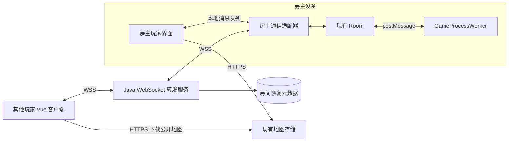

# MineMonopoly Java 对局消息转发方案评估

评估日期：2026 年 10 月 10 日。代码基线：`4621384`。方案状态：设计评估，尚未实现或压测。

范围更新：用户已确定 Unity 新版独立运行并逐步替换现有客户端，相关建议见 [Unity 新版架构评估](unity-platform-architecture-assessment.md)。本文仍适用于保留现有房主规则的通信改造，不能用其工期估算 Unity 新版或服务端权威规则迁移。

**方案 C 可行，适合以统一 Java 后端和简化连接运维为目标的改造。** 推荐使用 Spring Boot 原生 WebSocket 承担房间连接管理、身份校验和消息转发，保留房主设备上的 Room 与 GameProcessWorker。该方案能够移除新协议房间对 PeerJS、PeerServer 和 coturn 的依赖，但中央服务将成为所有在线对局的通信必经点。

核心取舍是：减少 P2P 连接协商和 NAT 穿透相关的运维工作，换取中央转发服务的带宽、可用性和扩容责任。房主仍决定游戏规则与状态；服务端转发不会自动实现反作弊、房主迁移或房主离线后的持续运行。

通信改造与上线验证预计 **12～20 人日**，加 25%～30% 缓冲后约 **15～26 人日**，熟悉 Java 与 TypeScript 的单人约 **3～6 周**。不包含全部 HTTP 业务改写为 Java，合并排期时应扣除鉴权、房间和部署的重复工作。

Java 与现有技术栈的选型对比见第 11 节。是否改用中央转发、是否改用 Java，是两个可以独立决定的改造范围。

## 1 现有实现与改造依据

| 当前事实 | 对方案 C 的影响 | 源码 |
| --- | --- | --- |
| 房主和客机经 PeerJS 连接，Room 持有每名玩家的 DataConnection | 需要抽象连接接口，不能只改服务器 URL | [MonopolyHost](../apps/client/src/core/monopoly-host/MonopolyHost.ts)、[Room](../apps/client/src/core/monopoly-host/Room.ts) |
| 房主创建主机后，自己的客户端同样执行 connect | 必须保留房主玩家的加入流程与本地消息回送 | [MonopolyClient](../apps/client/src/core/monopoly-client/MonopolyClient.ts) |
| 普通消息是 JSON，包含字符串化的 Infinity 和 -Infinity | 应复用现有序列化语义，避免 Java 转换改变载荷 | [WebRtcSessionManager](../apps/client/src/core/network/WebRtcSessionManager.ts) |
| 自定义地图使用 64 KiB 二进制分块，并按玩家逐个发送 | 需要二进制路由、有界发送队列和接收端流量控制 | [Room 地图传输](../apps/client/src/core/monopoly-host/Room.ts) |
| 自定义地图已有 SHA-256、加载会话 ID 和本地匹配流程 | 可以保留缓存命中和旧会话隔离能力 | [消息类型](../packages/types/interfaces/game/socket.ts)、[接收处理](../apps/client/src/core/monopoly-client/host-message-handlers.ts) |
| 普通玩家掉线后可进入 AI 托管，重连后重新发 GameInit | 可复用恢复基础，但要验证交互状态重建 | [GameProcessWorker](../apps/client/src/core/worker/GameProcessWorker.ts) |
| Worker 已有暂停入口，并暂停操作等待定时器 | 可在房主转发连接中断时接入暂停策略 | [Worker](../apps/client/src/core/worker/GameProcessWorker.ts)、[OperateListener](../apps/client/src/core/worker/class/OperateListener.ts) |
| 同屏模式通过模拟 DataConnection 复用 Room | 抽象连接后应继续支持，不应引入服务器依赖 | [LocalPartySession](../apps/client/src/core/local-party/LocalPartySession.ts) |
| 游客身份目前在客户端生成并本地保存 | 中央转发要引入可验证的游客会话身份 | [登录页面](../apps/client/src/views/login/login.vue) |
| 当前房间租约只在 Node 内存中 | 新转发服务若需重启恢复，必须明确恢复凭证与持久化边界 | [房间路由](../apps/server/src/routers/room-router.ts) |

房间代码有 6 个玩家座位的限制，也存在 AI 与房主旁观配置。容量计算应按真实网络连接数统计，不能把所有座位都视为一个远端连接。

## 2 推荐架构与责任划分



每个在线客户端保留一条 WSS 连接。房主的一条连接承载所有远端玩家与房主之间的消息；房主自己的玩家输入和界面响应通过本地队列进入相同的业务处理路径，避免绕服务器一圈，也避免因同步回调引入递归或执行顺序变化。

| 内容 | Java 转发服务 | 房主客户端 |
| --- | --- | --- |
| 连接身份与房间归属 | 校验账号或游客会话，绑定角色和连接代次 | 使用服务器确认的身份处理消息 |
| 房主资格 | 校验房间所有者、恢复凭证与 hostEpoch | 持有该房间的 Room 与 Worker |
| 加入与踢出 | 管理候选连接、准入结果、会话撤销 | 判断开局状态、座位及玩家加入规则，发出准入或踢出控制消息 |
| 房间广播与定向消息 | 校验发送方、收件人和消息大小后转发 | 生成对局事件、私有弹窗及状态 |
| 游戏动作合法性 | 拒绝错误方向、跨房间、伪造身份及无权限的管理消息 | 判断回合、金钱、卡牌、地产、地图脚本等业务规则 |
| 对局恢复 | 恢复连接路由、隔离旧连接与旧房主 | 提供当前状态并重建玩家交互 |
| 存档与 AI | 不执行游戏状态存档或 AI 决策 | 保留现有 IndexedDB 存档及 AI 流程 |

Java 的房间成员集合用于路由与权限，Room 的成员集合用于玩法。新连接先进入待准入状态，由房主确认后才成为可接收对局消息的成员；双方通过明确的控制消息同步，避免出现两套互不一致的房间名单。

第一版建议使用 Spring Boot 的原生 WebSocketHandler，自定义轻量消息封装即可。文本与二进制都可处理；发送必须串行化，Spring 提供 ConcurrentWebSocketSessionDecorator 等支持。[Spring WebSocket 官方文档](https://docs.spring.io/spring-framework/reference/web/websocket/server.html)

## 3 协议与身份设计

### 3.1 复用游戏消息并增加路由封装

保留 `SocketMsgType` 和原有游戏消息体，在外层增加转发协议。下面字段是设计提案，不是当前已存在的 API。

| 字段 | 用途 |
| --- | --- |
| `protocolVersion` | 区分新转发协议及后续兼容版本 |
| `roomId` | 房间定位，必须与已认证连接绑定一致 |
| `hostEpoch` | 当前房主连接代次，隔离重连前迟到的数据 |
| `connectionGeneration` | 单个玩家连接代次，旧连接回调不能使新连接下线 |
| `messageId` | 业务请求或事件标识，用于追踪和去重 |
| `sequence` | 检查单条逻辑流的顺序与缺口，不承担全房间事务排序 |
| `target` | 房主、指定玩家或明确批准的接收者集合 |
| `payload` | 原有 JSON 消息或带路由头的二进制块 |

`senderId` 和真实角色由服务器根据会话写入，不能相信客户端自报。现有消息中的 `source: server` 表示房主发出的游戏消息，不等于发送者天然拥有 Java 服务端权限。

客机游戏操作只能发送给房主；房主可向已准入玩家定向或广播。开局、踢人、换图等管理能力要有明确的权限白名单。Java 无须理解每个地图脚本，但必须限制消息方向、大小、速率和目标。

首版可以按收件人逐一转发，降低业务改动；若要减少房主上行流量，还需将 `roomBroadcast` 改为“发送一次，由 Java 分发”。简单替换 send 实现不会自动合并当前逐玩家广播。

### 3.2 连接鉴权

推荐先通过 HTTPS 为账号或游客签发短期、一次性的房间连接票据，再在 WSS 建立后的认证首包中提交。认证前只允许认证消息，限制等待时间和消息大小；票据绑定身份、房间、角色与用途，日志不记录票据正文。

浏览器原生 WebSocket 构造函数只接受 URL 和子协议参数，没有供应用设置任意 Authorization 请求头的参数。不能直接照搬 Axios 的 Bearer 拦截器。[WebSockets 标准](https://websockets.spec.whatwg.org/)

还需完成以下兼容工作：

- 保留游客体验，但由服务器签发可验证、可恢复的游客会话；不能仅凭 `temp-player-*` 字符串恢复他人的席位。
- 修正旧 JWT 毫秒级 exp 与 access/refresh 类型校验问题，再建立跨 Node 与 Java 的认证边界。
- 渐进迁移阶段，可由现有 API 签发 Java 可验证的短期票据；需配置稳定的签名密钥或受信服务调用，不能依赖 Node 每次启动生成的临时 RSA 密钥长期兼容。
- 对 Web、Electron 和 Capacitor 分别配置合法来源策略，结合票据验证。允许某个 Origin 本身不代表用户已经认证。

相关旧实现见 [Token](../apps/server/src/utils/token.ts)、[密钥生成](../apps/server/src/utils/rsakey.ts)与[游客入口](../apps/client/src/views/login/login.vue)。

## 4 重连与故障行为

连接状态建议采用 `CONNECTING → AUTHENTICATING → JOINING → SYNCING → READY`。WebSocket 打开不等于游戏已经恢复；只有地图、GameInit 和必要交互完成同步后才能接受玩家新操作。

| 场景 | 首版目标行为 | 必须验证的边界 |
| --- | --- | --- |
| 单个客机掉线 | 更新连接状态；超过宽限期后沿用离线 AI 托管；重连后恢复真人控制 | 旧连接 close 事件不能踢掉新连接；过期弹窗结果不得执行 |
| 房主 WSS 短断，页面和 Worker 仍存活 | 在安全检查点暂停规则，重连并完成玩家状态同步后恢复 | 已进入执行的命令不能假定可回滚；暂停要覆盖操作等待和 AI 请求返回处理 |
| 房主页面关闭或设备退出 | 房间结束；可按现有能力从本地存档另开一局 | Java 没有完整规则运行时，不能自动接任房主 |
| Java 进程重启 | 所有连接重连；存活房主验证恢复资格并重建路由，玩家重新同步 | 首版只有短暂停顿后的恢复能力，没有无中断承诺 |
| 切换地图期间断线 | 用 mapLoadSessionId 废弃旧传输，重新检查本地地图或重新传输 | 旧分块和旧 MapChunkEnd 不能污染新地图 |
| 玩家重复点击或断线重试 | 由房主按 messageId 及当前回合／交互标识去重 | 服务端“已接收”不能当成 Worker“已执行成功” |

不盲目回放断线前的所有按钮操作：掷骰子、买地、使用卡牌等非幂等动作默认不自动重发，先同步当前状态。去重必须落在实际执行入口，且记录执行中与完成状态；只在 Java 转发层去重不足以证明游戏动作只执行一次。

现有重连流程会重发地图并触发 Worker 的 GameStart/GameInit，普通掉线会启用 AI。需要逐项检查按钮、待回答弹窗、动画完成等待、路径选择、倒计时和 AI 控制状态是否完整恢复，不能把 GameData 快照等同于所有交互已经重建。

暂停状态需要按原因管理，例如“用户手动暂停”和“房主连接中断”分别持有暂停原因，网络恢复只解除自己的原因。自定义地图脚本采用协作式暂停，无法保证任意脚本能在任意指令处立即停止。

为支持 Java 重启后的受控恢复，使用现有 MySQL 保存最小房间元数据，例如房间身份、所有者、hostEpoch、恢复凭证摘要、到期时间和关闭标记；热路径消息与完整游戏状态仍保留在内存及房主。服务器不能在注册表丢失时无条件接受任意用户成为原房主。

## 5 地图传输与发送队列

### 5.1 官方地图与自定义地图分开处理

官方地图继续使用现有 HTTPS 下载路径，WebSocket 只传地图标识及控制消息。自定义地图优先复用 SHA-256 本地匹配流程，缺失时才转发二进制。首版保留现有按玩家传输方式；后续可将临时地图上传到对象存储，再由玩家下载，但那需要额外的临时授权、清理和失效策略。

当前 64 KiB 分块外层还要增加路由信息，服务端二进制消息上限必须高于“块大小加消息头”，不能简单设成恰好 64 KiB。JSON 状态快照的上限应根据真实最大地图采样确定。

### 5.2 有序传输不等于无限排队

当前 `startMapChunkTransfer` 一次循环发出全部块，再发送 MapChunkEnd。迁移后应改为有界窗口发送：

1. 房主按接收者分别维护发送窗口，只在存在可用额度时读取并发送下一批块。
2. 客户端检查 bufferedAmount，并以应用层接收确认补充接收额度；确认用于限制速度，不代表必须另做逐块重传。
3. Java 每条连接采用有上限的 FIFO 发送队列，文本和二进制共享明确的业务顺序；MapChunkEnd 必须排在对应全部块之后。
4. 接收缓慢时停止为该接收者增加块；超时后明确中止该次传输，不能无限积压或静默丢弃游戏操作。
5. 客机按字节数、块数及 SHA-256 校验完整性。首版断线后允许重新传输，断点续传可另行评估。

浏览器 WebSocket API 不提供自动接收背压，bufferedAmount 只反映本地待发送字节，不能代表远端已经处理完。因而客户端也需要协作限制传输速率。[MDN WebSocket 说明](https://developer.mozilla.org/en-US/docs/Web/API/WebSocket)

队列上限建议通过压测调整。作为内存预算示例，600 条连接每条最多排队 1 MiB，仅队列就可能占用 600 MiB，尚未计入 JVM、TCP 缓冲、JSON 对象和房主地图数据。单个慢客户端不能阻塞整个房间的其他连接。

## 6 延迟与带宽测算

本节全部为计算场景，不是现网统计或容量保证。假设每房间 1 名房主和 5 名远端玩家，均为真人，没有额外旁观连接；房主玩家本地回送不经过网络。

### 6.1 操作往返延迟

一次“玩家操作 → 房主处理 → 玩家收到结果”的网络时间近似为：

```text
RTT(玩家, Java 服务) + RTT(房主, Java 服务)
+ Java 两次转发耗时 + 房主规则处理耗时
```

若玩家与房主各自到服务器 RTT 都为 40 ms，则纯网络往返约 80 ms，另加处理与排队时间。它可能慢于良好的 P2P 直连，也可能优于绕路的 TURN 中继；必须在目标地区和移动网络上测量。动画完成回执会再次经过该链路，也应纳入测试。

现有界面将一次心跳往返时间除以 2 显示为 ping。新方案建议分别记录“客户端到 Java 的 RTT”及“客户端经 Java 到房主的应用 RTT”，避免以不明确的半程值判断体验。

### 6.2 游戏消息出站带宽

设房间数为 R，每房每秒向所有远端玩家广播 f 条消息，平均载荷为 S 字节，远端玩家数为 N：

```text
Java 出站字节每秒 ≈ R × f × S × N
```

以平均消息 2 KiB、每秒广播 10 条、5 个远端玩家计算：

| 场景 | Java 出站带宽 | 持续 1 小时出站数据 |
| --- | --- | --- |
| 1 个房间 | 100 KiB/s，约 0.82 Mbit/s | 约 0.37 GB |
| 100 个房间 | 约 9.77 MiB/s，81.92 Mbit/s | 约 36.86 GB |

以上未计入 TLS、WebSocket、TCP 开销，也不包含地图、定向消息、玩家上传及重传；这些会增加总量。当前每秒实际消息数和 GameData 大小需要采样，不能用“回合制”直接推断流量很小。

### 6.3 自定义地图出站带宽

假设地图 20 MiB，5 个远端玩家都没有本地副本，则每个房间需从 Java 发出约 100 MiB。100 个房间同时加载，出站总量约 9.77 GiB。

若保持当前逐玩家发送，房主向 Java 的总上传量同样约 100 MiB，而不是 20 MiB。只有引入共享文件上传或明确的一次上传后分发机制，才能减少这部分房主上行流量。

方案 C 的运营预算应先测量消息分布、地图大小、缓存命中率和同期开局量，再计算流量费用及机器规模。这里不指定未经压测的服务器规格。

## 7 部署与可用性

首版使用单个 Java 转发实例，复用已有 MySQL 保存恢复元数据，通过 HTTPS/WSS 入口部署。公开地图仍由现有静态服务或对象存储承载。连接数、队列、发送字节、转发耗时、断线原因和恢复结果应有指标；日志只记录必要标识与消息类型，避免整包记录票据、私有交互和地图内容。

反向代理需要正确转发 WebSocket Upgrade，并配置与心跳一致的空闲超时。Nginx 默认在上游 60 秒未发送数据时关闭连接，可通过超时配置或服务器定期发送 ping 调整。[Nginx 官方说明](https://nginx.org/en/docs/http/websocket.html)

相比当前成功建立的 P2P 连接，新方案中 Java 不可用会直接中断所有经过该实例的对局通信。首版应支持滚动升级前停止接收新房间、等待旧房间结束、必要时执行明确的恢复流程。

后续多实例可优先采用“同房间连接分配到同一实例”。负载均衡的普通用户粘性会话并不能保证全房间在同一实例；需要房间归属查询和路由。若房间跨实例，则还需内部转发及顺序设计。引入 Redis 本身不会解决连接迁移、完整游戏状态恢复或恰好一次执行。

## 8 代码改动范围

以下模块名中，新名字仅表示建议职责。

| 模块 | 改造内容 | 改动程度 |
| --- | --- | --- |
| [共享 socket 类型](../packages/types/interfaces/game/socket.ts) | 添加转发封装、握手、准入、恢复和错误类型 | 中 |
| [PeerClient](../apps/client/src/core/monopoly-client/PeerClient.ts) | 新增 WebSocket transport，替代 PeerJS 建连 | 高 |
| [WebRtcSessionManager](../apps/client/src/core/network/WebRtcSessionManager.ts) | 抽象统一会话接口，实现 RelaySessionManager，保留本地模式 | 高 |
| [MonopolyHost](../apps/client/src/core/monopoly-host/MonopolyHost.ts) | 将 Peer 管理改为房主转发适配，维护玩家逻辑连接 | 高 |
| [Room](../apps/client/src/core/monopoly-host/Room.ts) | DataConnection 改为最小连接接口，适配广播、地图限流及暂停 | 中到高 |
| [客户端消息处理](../apps/client/src/core/monopoly-client/host-message-handlers.ts) | 复用业务消息；验证地图和恢复状态 | 中 |
| [房主消息处理](../apps/client/src/core/monopoly-host/client-message-handlers.ts) | 接入可信发送者身份、管理权限及请求去重 | 中 |
| [LocalPartySession](../apps/client/src/core/local-party/LocalPartySession.ts) | 实现统一连接接口，移除伪装 DataConnection 的类型断言 | 小到中 |
| [GameProcessWorker](../apps/client/src/core/worker/GameProcessWorker.ts) | 保留规则主体，补齐网络暂停、恢复和执行去重边界 | 中 |
| [房间 API 调用](../apps/client/src/utils/api/room-router.ts) | 从 Peer ID／ICE 配置切换为 transport 类型、端点与票据 | 中 |
| Java 新模块 | 认证、房间控制、会话、消息路由、发送队列、恢复元数据、指标 | 高 |
| 连接状态 UI 与诊断 | 移除新房间的 P2P／TURN 策略显示，区分服务端与房主 RTT | 小 |
| 部署与配置 | Java 镜像、WSS、来源策略、协议开关、排空及回滚 | 中 |

最小连接接口应覆盖 Room 实际使用的 open、文本／二进制发送和关闭语义，返回排队是否成功或可等待的发送结果。避免把原 PeerJS 的完整 API 原样复制为新抽象。

## 9 工作量与迁移阶段

估算前提：1 名熟悉 Java 和 TypeScript 的开发者，复用当前游戏逻辑和地图格式，首版单实例，允许短维护窗口。含 Web、Windows Electron 和 Android 的关键回归，不包含 iOS、新的主机迁移能力或完整服务端权威游戏引擎。

| 工作 | 人日 |
| --- | ---: |
| 消息采样、契约、连接抽象设计 | 1～2 |
| Java 认证、房间准入和转发服务 | 2～3 |
| 客户端会话、房主适配与本地回送 | 2～3 |
| 重连、旧连接隔离、状态同步和去重 | 2～4 |
| 二进制地图、流量控制与完整性验证 | 2～3 |
| 跨端回归、故障测试、指标、部署和切换 | 3～5 |
| **首版合计** | **12～20** |
| **含缓冲的计划预算** | **15～26** |

阶段建议：

1. **验证阶段，2～3 人日，包含在总估算内**：建立房主与两名客机的 WSS 路径，完成真实加入、开局、一次游戏操作和自定义地图传输，记录消息大小与延迟。它只能证明路线可行，不等于可以上线。
2. **完整联调阶段**：补齐游客及账号认证、准入、踢人、广播、私有交互、同屏和 AI 功能，打通重连与限流。
3. **上线验证阶段**：完成代表性容量、跨端及故障测试，按房间类型开放新协议。

临时地图对象存储、断点续传、多实例调度、房主迁移属于额外范围，需根据验证结果单独估算。

过渡期由房间记录固定 `transport=peerjs` 或 `transport=ws-relay`。旧客户端继续进入旧协议房间；新客户端根据协议创建对应 transport。同一进行中的房间不自动切换通信协议，回滚只影响新建房间，已有转发房间应排空或按明确的恢复流程结束。

## 10 验收与决策条件

| 验收项 | 最低要求 |
| --- | --- |
| 完整玩法 | 账号与游客、满员房间、房主玩家、旁观、AI、聊天、准备、换图、开局与结算符合现有行为 |
| 交互恢复 | 在掷骰、选路、弹窗、动画、地图加载期间断线重连，状态与操作归属正确 |
| 消息权限 | 不能跨房间收发、冒充房主、伪造他人操作或在被踢后继续发送 |
| 去重与顺序 | 重复 messageId 不重复扣款或掷骰；旧连接与旧 hostEpoch 消息被拒绝 |
| 慢接收者 | 限速客机导致的队列有上限，其余玩家仍可收发；传输失败可解释和重试 |
| 地图 | 本地命中、缺失、错误 hash、大小上限、切图取消、传输中断均可正确处理 |
| 故障 | Java 重启、房主网络短断、房主进程退出、客户端前后台切换都有明确结果 |
| 跨端 | Web、Windows Electron、Android 实际连接与恢复验证；本地同屏无网络回归 |
| 容量 | 先用假设的 100 房间、600 连接执行至少 30 分钟代表性负载，并加入地图突发；记录实际 CPU、内存、GC、网络和队列，不把此规模视为已支持承诺 |
| 延迟 | 分别记录 Java 转发排队、到服务器 RTT、到房主应用 RTT；可将正常负载下单次 Java 转发 p95 小于 20 ms 作为初始目标，最终门槛依设备和目标地区测试确定 |

**建议通过验证阶段后推进方案 C。** 适用条件是接受房主继续运行规则，并愿意承担中央消息转发的带宽和可用性成本。若目标是房主退出后仍持续游戏，应另立服务端权威运行时方案，不能将其归入本次通信替换。

## 11 Java 与现有技术栈的选择

**以当前项目的已有代码和迁移投入看，默认建议继续维护 TypeScript 与 Node.js；需要统一到 Java 团队或已有 Java 基础设施时，再采用 Java。** 若主要目标是改善连接体验和集中排查通信故障，则单独评估 WebSocket 转发。方案 C 在满足这些目标时可行，但可行性本身不代表它比保留现状更划算。

### 11.1 三种范围的实际差异

| 维度 | 保留 Node.js 与 WebRTC | 只将 HTTP API 改为 Java | 方案 C 使用 Java 转发对局 |
| --- | --- | --- | --- |
| 核心变化 | 继续维护现有实现 | 重写账号、地图、房间登记等业务接口 | 替换对局通信链路；HTTP API 可暂留 Node.js |
| 游戏规则在哪里执行 | 房主浏览器的 Worker | 房主浏览器的 Worker | 房主浏览器的 Worker |
| 玩家通信路径 | 玩家直连房主，必要时走 TURN | 与原来相同 | 玩家经 Java 服务到房主 |
| NAT 穿透维护 | 维护 PeerServer、ICE 和 coturn | 仍需维护这些组件 | 新协议房间无需这些组件，改为维护 WSS 入口与长连接 |
| 玩家可感知的收益 | 取决于针对现有问题的修复 | API 兼容时通常没有直接的对局变化 | 有机会改善部分网络环境的连接体验，需实测连接成功率与重连效果 |
| 延迟 | 取决于直连质量或 TURN 路径 | 对局路径不变 | 取决于玩家及房主到服务器的路径，不能承诺更低 |
| 对局流量成本 | 直连数据不经过中央中继；TURN 承载的流量仍有成本 | 基本保留原结构 | 全部远端对局消息经过转发服务，需预算地图突发流量 |
| 故障影响 | 已建立直连的数据路径不依赖信令转发；API、重连和 TURN 仍各有依赖 | 保留原有对局故障边界 | 转发实例故障直接影响其承载的全部房间 |
| 房主退出与反作弊 | 依赖房主，房主掌握规则状态 | 相同 | 相同；可加强身份与消息权限，但没有独立规则裁判 |
| 维护与协议 | 前后端共享 TypeScript 类型 | 增加 Java 与 TypeScript 的接口契约维护 | 增加跨语言消息契约及前端通信适配；过渡期同时部署 Node 与 Java |
| 扩容责任 | 中央信令、API 与 TURN 分别扩容，规则计算分散在房主 | API 可独立扩容，其他责任相同 | 还需管理长连接、房间归属、发送队列及中继带宽 |

PeerServer 的职责是协助建立连接，不代理对局数据；不能把当前 Node 服务的资源消耗与未来 Java 全量转发的资源消耗直接比较。两者承担的工作不同。[PeerServer 官方说明](https://github.com/peers/peerjs-server)

游戏 Worker 的创建位置见 [Room](../apps/client/src/core/monopoly-host/Room.ts)，当前 HTTP 与信令入口见 [app.ts](../apps/server/app.ts)。以上三种方案均不迁移完整游戏运行时，因此不会直接提高渲染帧率、加快房主规则计算或自动接管退出的房主。

### 11.2 相同转发架构下的 Java 与 Node.js

Node.js 也能实现中央 WebSocket 转发。[ws 官方项目](https://github.com/websockets/ws)提供 Node WebSocket 服务端实现；本仓库已经声明 `ws` 依赖，但现有历史 RoomRouter 不等于已完成可上线的对局转发服务。

| 对比项 | Node.js 转发 | Java 转发 |
| --- | --- | --- |
| 当前项目复用 | 可复用已有认证模块和共享类型，仍要补齐运行时校验 | 需实现认证桥接或迁移，维护 Java DTO 与 TypeScript 契约 |
| 并发实现注意点 | 保持事件循环上的处理短小，避免大 JSON、同步压缩等阻塞 | 明确线程或事件循环模型，串行发送并保证房间状态一致性 |
| 相同消息流量 | 同样承担全部转发带宽 | 同样承担全部转发带宽 |
| 稳定性工作 | 限流、有界队列、重连、去重、监控、房间路由 | 同样需要这些工作；框架不会自动补齐业务恢复 |
| 团队与工程成本 | 适合继续维护当前 TypeScript 工作区的团队 | 适合已有 Java 开发、发布、监控和运维能力的团队 |
| 性能与机器费用 | 根据真实消息和地图负载压测 | 用相同负载与硬件压测；不能预设更快或更省内存 |

Node.js 的事件驱动模型可以处理大量较轻的网络任务，重 CPU 操作或大对象处理可能阻塞其他客户端；这需要通过实现和测量控制。[Node.js 官方说明](https://nodejs.org/en/learn/asynchronous-work/dont-block-the-event-loop)

Java 同样需要控制并发和队列。例如，Spring 原生 WebSocket 会话的发送需要同步，不能从多个线程无约束地同时发送。Java 的并发能力不等于单个房间可以任意并行处理。[Spring WebSocket 官方文档](https://docs.spring.io/spring-framework/reference/web/websocket/server.html)

当前共享类型位于 [packages/types](../packages/types/package.json)。迁移 Java 时，建议对 HTTP 使用明确的接口契约，对实时消息使用带版本的 Schema 和兼容性测试；前端 TypeScript 类型检查与 Java 类型检查都不能代替对外部输入的运行时验证。

### 11.3 投入与决策建议

| 路线 | 迁移投入与边界 |
| --- | --- |
| 继续现有技术栈 | 没有语言重写成本；现有鉴权、部署、重连与工程验证问题仍需修复，不能视为零维护成本 |
| Java HTTP API，保留现有通信 | 前次静态估算 18～28 人日，包含现有业务兼容与联调；不包含改造对局通信 |
| Java 对局转发，保留房主规则 | 本文估算 12～20 人日，含缓冲 15～26 人日；不包含全部 HTTP API 重写 |
| Node.js 对局转发 | 可节省部分认证、共享类型及运行环境适配；客户端通信、地图、重连和回归工作仍然存在，需要按相同验收范围估算 |

若同时迁移 API 和通信，应合并鉴权、房间管理、部署及联调任务后重新排期，不能直接叠加两项估算。团队熟练度不同会显著影响这些范围。

建议按目标选择：

- **希望近期快速迭代、控制重写投入**：继续使用现有 Node.js 与 WebRTC，先修复已识别问题并收集连接指标。
- **主要痛点是联机失败或难以排查通信**：验证中央 WebSocket 转发，Java 和 Node.js 都列入候选；收益取决于连接架构和实现质量。
- **团队主要维护 Java，准备统一业务后端**：采用 Java 有长期维护价值；把 API 迁移与通信切换拆成可单独验收的阶段。
- **要求房主退出后继续游戏或服务端判定作弊**：另行评估权威游戏服务，需要迁移规则、脚本和状态管理，超出当前方案 C。

在投入重写前，至少采集建连失败原因、直连与 TURN 比例、操作 RTT、重连成功率、消息大小与频率，以及地图传输峰值。前述数据能判断应优先修复网络路径、转发架构或后端处理，而语言本身不能替代这一步。
