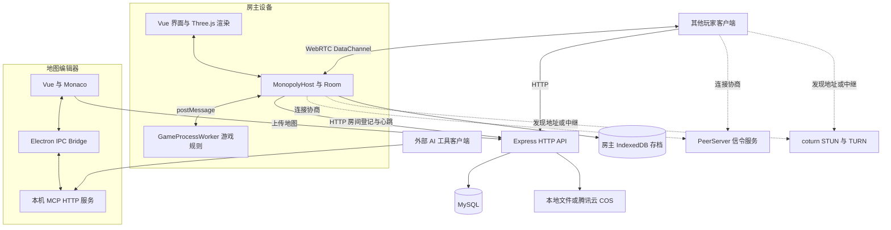

# MineMonopoly 技术架构与技术栈评估

评估日期：2026 年 10 月 10 日。代码基线：`4621384`。适用读者：项目维护者、接手开发者和部署人员。

后续产品方向已明确为 Unity 新版独立运行并逐步替换现有客户端。下文描述现有系统；新版技术选型与迁移边界见 [Unity 新版架构评估](unity-platform-architecture-assessment.md)。

MineMonopoly 是一套以 TypeScript 为主的多人桌游与地图创作系统。Vue 负责界面，Three.js 负责主要游戏渲染，房主客户端的 Web Worker 执行游戏规则，PeerJS/WebRTC 传递对局消息，Express 与 MySQL 提供账号、房间登记和地图管理服务。

**建议保留现有技术栈继续演进。** 它与回合制桌游、可编程地图和跨端界面的需求匹配，地图编辑器、共享类型和运行时之间已经形成复用基础。下一阶段应优先修正配置暴露、鉴权、持久化和工程验证问题，再拆分大型游戏模块。若产品需要强反作弊或房主离线后持续运行，则需要另行设计服务端权威对局架构。

本评估以仓库源码、依赖锁文件和部署配置为依据，属于静态架构评估。当前工作区未安装项目依赖，未执行应用构建、数据库连接、多人联机及设备兼容性测试；因此平台成熟度和运行可靠性不能仅由代码存在来证明。

## 1 项目组成

仓库采用 [pnpm workspace 配置](../pnpm-workspace.yaml) 管理 4 个应用和 6 个共享或历史包，没有额外的任务编排层。

| 模块 | 当前版本 | 职责与边界 |
| --- | --- | --- |
| [游戏客户端](../apps/client/package.json) | 1.3.2 | 登录、房间、游戏渲染、房主逻辑、存档、AI 玩家及跨端适配 |
| [地图编辑器](../apps/map-editor/package.json) | 1.3.3 | 可视化地图编辑、玩法脚本、资源管理、地图导出与 MCP 工具 |
| [中央服务](../apps/server/package.json) | 1.0.1 | HTTP API、认证、房间租约、地图审核、文件存储、PeerJS 信令及后台静态页面 |
| [管理后台](../apps/admin/package.json) | 0.0.0 | 用户、创作者、地图与统计管理 |
| [共享类型](../packages/types/index.ts) | 1.0.0 | 游戏实体、命令、修饰器、AI、地图和消息协议 |
| [共享工具](../packages/utils/package.json) | 1.0.0 | 地图格式、Protobuf、压缩加密、富文本、地图路径及 Three.js 工具 |
| [环境变量包](../packages/env/package.json) | 1.0.0 | Node 环境读取、浏览器读取和 Vite 注入插件 |
| [UI 组件包](../packages/components/ui/package.json) | 1.0.0 | 可复用 Vue 游戏组件 |
| [样式包](../packages/style/package.json) | 1.0.0 | SCSS 变量、函数、布局与主题样式 |
| [历史登录包](../packages/components/login/package.json) | 0.0.0 | 清单标记为 `deprecated: true`，不应作为新功能入口 |

应用与共享包通过 `workspace:*` 和源码别名连接。Vue、Three.js、Vite 等较多依赖集中声明在[根清单](../package.json)，子应用的依赖清单不能单独代表完整运行环境。

## 2 技术栈清单

下表版本来自当前 [pnpm-lock.yaml](../pnpm-lock.yaml)，表示仓库锁定结果，不表示最新版本或本机已安装版本。清单中的 `^` 范围与锁定版本可能不同，例如 TypeORM 声明 `^0.3.11`，实际锁定 `0.3.28`。

| 层次 | 技术及锁定版本 | 项目中的用途 |
| --- | --- | --- |
| 语言与类型检查 | TypeScript 5.9.2、vue-tsc 3.2.8 | 共享类型、Vue 单文件组件检查、脚本类型支持 |
| 界面 | Vue 3.5.18、Vue Router 4.6.4、Pinia 2.0.33 | 页面、导航和响应式状态 |
| UI 与样式 | Ant Design Vue 4.2.6、Sass 1.58.3 | 编辑器与后台组件、游戏样式 |
| 3D 渲染 | Three.js 0.179.1 | 地图、角色、卡牌、模型预览 |
| 动画与物理 | GSAP 3.15.0、cannon-es 0.20.0 | 动效与客户端骰子物理表现 |
| 辅助 2D 与音频 | PixiJS 8.14.0、Howler 2.2.4 | 自定义 UI 编辑相关组件、音效播放 |
| 代码编辑 | Monaco Editor 0.50.0、ts-morph 26.0.0 | 玩法脚本编辑、类型声明和校验工具 |
| 后台图表 | AntV G2 5.4.8 | 用户及游戏统计图表 |
| Web 构建 | Vite 5.4.21、Rollup 相关插件 | Vue 构建、Worker 打包、分包、体积分析 |
| 桌面端 | Electron 37.2.6、electron-builder 26.0.12 | 桌面窗口、文件系统桥接、安装包 |
| Android 壳 | Capacitor 8.4.0、Capgo Updater 8.49.1 | Android WebView 容器与更新链路 |
| HTTP API | Express 4.18.2、Axios 1.11.0 | 中央业务接口和客户端调用 |
| 实时网络 | PeerJS 1.5.5、peer 1.0.2、coturn | WebRTC 数据通道、信令、STUN/TURN |
| 数据访问 | TypeORM 0.3.28、mysql2 2.3.3 | MySQL 实体、查询和连接池；驱动以 `mysql` 别名安装 |
| 身份认证 | jsonwebtoken 9.0.3、JSEncrypt 3.5.4 | RS256 Token 与登录相关加密流程 |
| 地图文件 | protobufjs 7.5.3、pako 2.1.0、Web Crypto | 二进制封装、压缩和 AES-CBC 加解密 |
| 编辑器 AI 接口 | MCP SDK 1.28.0、Zod 3.25.76 | 工具协议、参数结构和本地 HTTP 服务 |
| 工程与发布 | pnpm 10.10.0、Changesets 2.30.0、GitHub Actions | 依赖、版本记录和发布工作流 |

需要区分依赖声明与实际职责：主游戏渲染以 Three.js 为中心，PixiJS 的直接使用位于编辑器的自定义 UI 选择器。后台清单还声明了 CodeMirror；不能据此将它视为当前地图脚本编辑主方案。

运行时基线存在差异：[发布工作流](../.github/workflows/release.yml) 使用 Node.js 22，[Dockerfile](../docker/Dockerfile) 使用 Node.js 20，README 写的是 Node.js 20+。本机读取到 Node.js 25.8.1、pnpm 8.9.2，与仓库声明不一致。开发环境应先对齐仓库 pnpm 10.10.0，并以现有 CI 的 Node.js 22 环境复现构建。

## 3 系统架构与通信



### 3.1 中央服务与房主的责任

[服务入口](../apps/server/app.ts) 启动业务 API、PeerServer 和管理后台静态服务。中央服务不执行每回合的完整游戏规则；规则由房主设备上的 [Room](../apps/client/src/core/monopoly-host/Room.ts) 创建 Worker 执行，再向玩家分发状态和事件。

对局采用以房主为中心的连接结构。其他玩家通过 [PeerClient](../apps/client/src/core/monopoly-client/PeerClient.ts) 连接房主，并非每位玩家都互相建立连接。由此减少中央规则计算负担，但房主设备的性能、联网状态与可信度直接影响对局。

### 3.2 实际使用的协议

| 链路 | 实际实现 | 关键入口 |
| --- | --- | --- |
| 账号、地图、房间登记与心跳 | HTTP 请求 | [API 调用](../apps/client/src/utils/api/room-router.ts)、[房间路由](../apps/server/src/routers/room-router.ts) |
| 玩家到房主 | PeerJS WebRTC DataConnection | [MonopolyHost](../apps/client/src/core/monopoly-host/MonopolyHost.ts) |
| 对局消息载荷 | 普通消息为 JSON 字符串；自定义地图另用二进制分块；接收时处理特殊数值 | [MonopolyHost](../apps/client/src/core/monopoly-host/MonopolyHost.ts)、[会话接收](../apps/client/src/core/network/WebRtcSessionManager.ts) |
| 房主主线程到规则线程 | Worker `postMessage` | [Room](../apps/client/src/core/monopoly-host/Room.ts)、[Worker 消息类型](../apps/client/src/interfaces/worker.ts) |
| 地图产物文件 | Protobuf 外层封装及资源字节 | [产物编码](../packages/utils/protos/product.ts) |
| AI 编辑器工具调用 | MCP Streamable HTTP，再经 Electron IPC | [HTTP 服务](../apps/map-editor/src/mcp/http-server.ts) |

README 架构图中的 `Socket.io` 与当前入口不一致。仓库存在使用 `ws` 的历史 [RoomRouter 类](../apps/server/src/classes/RoomRouter.ts)，但当前 `app.ts` 装载的是 HTTP 房间路由。Protobuf 主要服务于地图文件，不应将实时 JSON 消息描述为 Protobuf 协议。

### 3.3 联机与恢复流程

1. 客户端调用 `/room-router/join`，获取已有房主的 Peer ID，或取得创建房间所需的租约信息，同时获得 ICE 服务器配置。
2. 新房主创建 Peer 和 Room，通过 `/emit-host` 登记 Peer ID；其他玩家通过 PeerJS 连接房主。
3. 房主加载地图并创建 `GameProcessWorker`，向玩家同步初始化数据与后续对局事件。
4. 房主定期向中央服务发送 HTTP 心跳。当前建议间隔为 5 秒，租约为 30 秒，到期后提供 60 秒宽限期。
5. [WebRtcSessionManager](../apps/client/src/core/network/WebRtcSessionManager.ts) 管理连接恢复；房间接口提供状态查询和 `reclaim-host`，供原房主恢复登记。

房间注册表是服务进程内的 `Map`。服务重启会丢失注册信息，虽然已有房主夺回登记逻辑，但这不等于共享房间存储、自动主机迁移或跨实例高可用。扩容中央服务前，应先设计房间共享状态、租约一致性与路由策略。

## 4 游戏与地图核心设计

### 4.1 游戏规则运行时

[GameProcessWorker](../apps/client/src/core/worker/GameProcessWorker.ts) 负责游戏初始化、阶段、操作等待、路径选择、AI 决策桥接和状态导出。Player、Property、ChanceCard 和 GamePhase 等类承载具体实体能力。

[CommandBus](../apps/client/src/core/worker/class/action-system/CommandBus.ts) 按 `before 修饰器 → 命令处理 → after 修饰器 → 次数消耗` 执行动作，支持取消、覆盖结果、跳过消耗和自定义消耗次数。配合共享接口，这种设计适合地图作者扩展规则，避免每张地图都复制主流程。

地图脚本经 TypeScript 转译后以 `new Function` 执行。当前 [Worker 限制代码](../apps/client/src/core/worker/security.ts) 屏蔽部分网络 API 并冻结核心原型，这是防护措施，但不构成针对恶意脚本的完整隔离证明。死循环、资源耗尽及消息边界仍需要独立验证。

### 4.2 渲染与界面

Vue 与 Pinia 管理房间、玩家、交互和界面状态，Three.js 渲染游戏场景；GSAP 提供动画，cannon-es 用于骰子表现，Howler 管理音频。渲染层与规则 Worker 分离，有利于控制 UI 阻塞，但 Worker 消息大小、频率及主线程处理开销仍会影响体验。

自定义界面采用 [UISchema 类型](../packages/types/interfaces/game/game-process/ui.ts) 和 [UI 渲染器](../apps/client/src/components/utils/ui-renderer/ui-renderer.vue)，使地图规则可以输出结构化弹窗、表单及按钮。修改 Schema 时应同时考虑编辑器、共享类型和客户端渲染器兼容性。

### 4.3 地图源文件与游戏产物

地图具有两类用途不同的表示：

- **可编辑源数据**：当前编辑器支持目录式地图工程，并兼容旧 `.fpmap` 二进制文件；[序列化服务](../apps/map-editor/src/services/map-serializer.ts) 负责转换与加载。
- **游戏产物 `.mmmap`**：地图 JSON、模型与图片资源先封装为 Protobuf，通常再 gzip 压缩，最后以 AES-CBC 加密。文件包含 `MMMP` 标记和随机 IV；客户端按相反顺序解码，并兼容未压缩产物。

对应实现为[编辑器导出](../apps/map-editor/src/utils/file/index.ts)、[客户端加载](../apps/client/src/utils/file/game-map.ts)和[加解密工具](../packages/utils/crypto/index.ts)。Protobuf 外层中的 `payload` 仍是地图 JSON 字符串，不能将所有地图业务字段都理解为独立的 Protobuf 字段。

目录工程具有 `.snapshots/` 快照机制，见[快照服务](../apps/map-editor/src/services/snapshot-service.ts)。仓库还保留 [isomorphic-git 服务](../apps/map-editor/electron/git-service.ts)，但当前快照实现不依赖 Git，应区分两套机制。

### 4.4 本地存档与同屏模式

[存档存储](../apps/client/src/core/save/IndexedDBSaveStorage.ts) 使用 IndexedDB，数据库名为 `mine-monopoly-saves`，当前版本为 3，并以地图及版本建立索引。此类存档位于设备本地，中央 MySQL 中的游戏记录不等于可恢复的完整对局存档。

[LocalPartySession](../apps/client/src/core/local-party/LocalPartySession.ts) 复用 Room，通过本地连接适配和控制权交接支持同屏玩家；代码中的座位上限为 6，包含 AI 占用的座位。网络模式与同屏模式共用规则，后续改动应覆盖两种输入路径。

### 4.5 两类 AI 能力

**编辑器 AI** 通过 MCP 读取和修改地图内容。[工具注册表](../apps/map-editor/src/mcp/tools/registry.ts) 覆盖地图元素、路径、地产、角色、机会卡、阶段、修饰器、UI、资源、变更应用及校验。Electron 主进程默认监听 `127.0.0.1`，HTTP 服务以 `/mcp` 接收 POST，再经 IPC 调用渲染进程中的地图服务。

**游戏 AI** 在 Worker 内整理候选动作与决策上下文，再通过房主主线程请求远端模型。[决策 Provider](../apps/client/src/core/ai/OpenAICompatibleDecisionProvider.ts) 实现 OpenAI 兼容与 Anthropic 请求格式、超时、返回结果归一化及用量记录。这与地图编辑器的 MCP 是不同链路，远端决策仍需受可执行候选与游戏规则约束。

## 5 后端与数据存储

### 5.1 业务接口

| 路由前缀 | 职责 |
| --- | --- |
| `/user` | 注册、登录、Token、用户与创作者相关功能 |
| `/room-router` | 加入、登记房主、心跳、租约恢复、房间状态 |
| `/game-map` | 地图列表、上传、审核、版本及地图访问相关功能 |
| `/statistics` | 管理后台统计数据 |
| `/coturn` | TURN 相关管理与指标接口 |
| `/static` | 服务端 `public` 目录中的静态资源 |
| `/health` | 简单存活响应；不进行实时依赖健康检查 |

入口及顺序见 [app.ts](../apps/server/app.ts)。`/health` 注册在全局鉴权中间件之后，且未列入当前匿名白名单，因此不能直接假定匿名探针会得到 200。

### 5.2 数据模型

[数据库连接配置](../apps/server/src/db/dbConnecter.ts) 注册 5 个实体：

| 实体 | 主要数据 |
| --- | --- |
| [User](../apps/server/src/db/entities/User.ts) | 账号、角色、管理员及创作者标识、在线状态、上传额度 |
| [GameMap](../apps/server/src/db/entities/GameMap.ts) | 地图元信息、公开及待审文件 URL、版本、作者、审核状态、更新日志 |
| [GameRecord](../apps/server/src/db/entities/GameRecord.ts) | 房间记录、时长、地图标识和时间 |
| [MapKey](../apps/server/src/db/entities/MapKey.ts) | 用户关联的地图上传访问 Key 和撤销状态 |
| [AdminAuditLog](../apps/server/src/db/entities/AdminAuditLog.ts) | 管理操作、操作者、目标用户与详情 |

地图二进制、图片和模型经[存储工厂](../apps/server/src/utils/storage/factory.ts)选择本地磁盘或腾讯云 COS；数据库保存元数据及 URL。当前数据库名称在代码中固定为 `monopoly`，`.env.example` 中的 `MYSQL_DATABASE` 没有被该连接配置读取。

### 5.3 配置边界

| 配置组 | 关键项 | 使用方 |
| --- | --- | --- |
| 服务地址 | `PROTOCOL`、`MONOPOLY_DOMAIN`、各端口及 `*_BASE_PREFIX` | 客户端、编辑器、后台、服务端 |
| 数据库 | `MYSQL_HOST`、`MYSQL_PORT`、用户名、密码、连接池参数 | 服务端 |
| TURN | `TURN_SECRET`、`TURN_TTL`、TURN/STUN 地址及端口 | 服务端与 coturn；客户端只需派生出的临时凭证 |
| 对象存储 | `TC_ID`、`TC_KEY`、`TC_BUCKET_NAME`、`TC_REGION` | 服务端 |
| 地图产物 | `MAP_ENCRYPT_KEY` | 导出端与加载端；要求 16 字节 |

Node 端通过 dotenv 读取配置；浏览器端通过 Vite 注入，后台还支持 `/env.js` 运行时覆盖。`env<T>()` 的泛型不保证实际数值转换：当前主要针对端口和协议做处理，连接池大小等数字参数仍需完善解析。实现见 [Node 配置](../packages/env/src/index.ts)、[浏览器配置](../packages/env/src/browser.ts)与 [Vite 插件](../packages/env/src/vite-plugin-env.ts)。

## 6 开发与发布路径

### 6.1 初始化与开发命令

在 Node.js 22、pnpm 10.10.0 环境下，基础准备顺序如下。命令反映仓库现有脚本；服务端启动缺口见下一小节。

```bash
cp .env.example .env
# 编辑 .env，填入本地数据库、服务地址、端口及地图密钥
pnpm install --frozen-lockfile
pnpm --filter @mine-monopoly/env build

# 分别在独立终端启动所需应用
pnpm dev-client
pnpm dev-editor
pnpm dev-admin
pnpm dev-server
```

`@mine-monopoly/env` 的包导出指向 `dist`，因此要先构建。客户端、编辑器和后台的开发端口分别为 5173、5174、5175。客户端默认开发模式会启用 Electron 插件；若只需浏览器界面，可使用 `pnpm --filter @mine-monopoly/client exec vite --mode web --host`，默认页面基础路径为 `/monopoly/`。

当前开发与部署配置有以下差异需要处理：

- 服务端 `dev` 脚本调用 `tsx`，但 workspace 清单和锁文件没有声明它。应补充明确的开发依赖后再把该命令作为可复现入口。
- 服务端 `build` 是 `tsc`，`start` 是 `tsc && node dist/app.js`；包中的 `#src/*` 映射却仍指向源码目录。需要验证并修正编译产物解析，不能把 Docker 的 esbuild 打包成功等同于该启动路径成功。
- `.env.example` 端口是 81、82、83，而 Compose 端口插值缺省值是 8081、8082、8083。应统一配置，避免访问地址与容器映射错位。

### 6.2 构建产物

| 目标 | 仓库命令 | 产物或作用 |
| --- | --- | --- |
| 客户端桌面包 | `pnpm build-client` | 前端及 Electron 构建、桌面安装包 |
| 客户端 Web | `pnpm --filter @mine-monopoly/client build:web` | `apps/client/dist/frontend` |
| 编辑器桌面包 | `pnpm build-editor` | 编辑器前端、Electron 主进程及安装包 |
| 管理后台 | `pnpm --filter @mine-monopoly/admin build` | `apps/admin/dist` |
| Android Web 资源 | `pnpm --filter @mine-monopoly/client build:capacitor` | Web 资源；APK 还需要 Capacitor 同步与 Gradle 构建 |
| 中央服务镜像 | `pnpm docker:build` | 打包服务端并携带管理后台 |
| 已有类型检查 | `pnpm check-all` | 仅检查客户端和地图编辑器 |

客户端及编辑器的安装包配置将桌面产物放在各自的 `dist/electron/<version>`。默认 `build-client` 包含 electron-builder，不等于只生成网页静态文件。

### 6.3 平台支持与发布

| 平台 | 当前仓库证据 | 能够得出的结论 |
| --- | --- | --- |
| Web | 独立 Vite 构建模式、静态产物与部署任务 | 已有完整发布配置，实际浏览器兼容性待实测 |
| Windows | Electron NSIS 配置、Windows CI | 已有桌面构建与发布任务 |
| Android | Capacitor 工程、APK CI、更新代码 | 已有实现和发布配置，README 的“计划开发中”已落后于代码 |
| macOS | dmg/zip 配置、entitlements、根目录构建脚本 | 已有打包入口，当前发布流程没有对应构建任务 |
| Linux | AppImage 配置 | 配置层支持，当前发布流程没有对应构建任务 |
| iOS | Capacitor 中存在 iOS 配置字段 | 尚无对应原生工程和发布流程，不能据此宣称已经支持 |

[发布工作流](../.github/workflows/release.yml) 由 `client-v*` 和 `map-editor-v*` 标签触发，涉及 Windows 安装包、客户端 Web、Android、R2 上传、Web 部署及 Release。它承担发布工作，尚未形成 pull request 阶段统一执行类型检查和测试的质量门禁。

### 6.4 容器部署条件

[Dockerfile](../docker/Dockerfile) 先安装依赖、构建 env 包，通过 `pnpm deploy --legacy` 整理依赖，再用 esbuild 将服务端打成 `server.js`，最后打包后台静态页面。

[Compose](../docker/docker-compose.yml) 包含业务服务和 coturn，但不包含 MySQL、反向代理或数据库备份。它要求预先存在外部 Docker 网络 `monopoly-network`，依赖 `docker/.env` 和宿主机 coturn 配置、证书目录；根目录 `.env` 并不能替代这些部署条件。coturn 的 host 网络与 `/www/wwwroot/...` 路径也使当前配置更接近特定服务器部署模板。

## 7 技术评估与改进优先级

### 7.1 值得保留的设计

| 设计 | 对项目的价值 | 适用边界 |
| --- | --- | --- |
| TypeScript 共享类型与 monorepo | 编辑器、客户端和规则接口可共同演进 | 类型不能替代运行时输入校验 |
| Vue 与 Three.js 分工 | 同时覆盖常规界面和桌游场景 | 需要管理 Vue 更新、GPU 资源释放与场景生命周期 |
| 房主 Worker 执行规则 | 将规则计算从 UI 主线程分离，降低中央服务计算需求 | 房主是可用性和公平性的重要依赖 |
| 命令与修饰器系统 | 方便地图作者组合玩法 | 需要稳定的执行顺序、消耗语义和兼容测试 |
| 编辑器服务与 MCP 桥接 | 人工编辑与 AI 工具共享内容能力 | 校验、并发调用和错误恢复需持续完善 |
| 共享存储接口 | 可在本地磁盘与 COS 间切换 | 部署路径、备份和文件生命周期必须一致 |

这些判断依据模块边界与代码结构，不代表已测得性能提升、并发容量或可用性指标。

### 7.2 P1 下一次对外发布前优先处理

**前端构建环境变量注入过宽。** [Vite 环境插件](../packages/env/src/vite-plugin-env.ts) 会合并过滤后的全部 `process.env`；三个应用调用时只显式排除 `MYSQL_PASSWORD` 和 `TC_KEY`，覆盖了插件默认的更广排除规则。诸如 TURN 密钥、其他 Token 或构建环境凭证可能进入前端定义。`include` 虽在接口中声明，却未实际参与过滤。应改为明确的公开变量白名单，并以假密钥做产物扫描验证；是否已有真实泄露，需要检查实际构建产物才能确认。

**JWT 过期时间单位与 Token 类型校验存在问题。** [token.ts](../apps/server/src/utils/token.ts) 将 `Date.now() + expire` 的毫秒值写入 `exp`，而 jsonwebtoken 的 `exp` 使用秒，因此服务端验签不会按预期时长判定 Token 过期。应统一为秒或使用 `expiresIn`。[鉴权中间件](../apps/server/src/utils/role-validation.ts) 调用 `verToken(token)` 时未要求 `access` 类型，还应限制 refresh Token 仅用于刷新链路。单位语义见 [jsonwebtoken 官方说明](https://github.com/auth0/node-jsonwebtoken#token-expiration-exp-claim)。

**容器本地文件持久化路径不一致。** Docker 运行目录是 `/app`，本地存储写入相对目录 `./public`，静态服务同样读取 `public`，实际对应 `/app/public`；Compose 卷却挂载在 `/app/apps/server/public`。使用本地存储时，上传文件没有落入该持久化卷，容器重建存在数据丢失风险。应统一挂载路径，并用“上传 → 重建容器 → 再次读取”的过程验收。依据为 [Dockerfile](../docker/Dockerfile)、[Compose](../docker/docker-compose.yml)和[本地存储实现](../apps/server/src/utils/storage/local-provider.ts)。

**数据库自动同步没有区分生产环境。** [DataSource](../apps/server/src/db/dbConnecter.ts) 固定设置 `synchronize: true`。生产发布应改为可审查的迁移、备份与回滚流程，避免实体改动在启动时直接影响数据结构。参见 [TypeORM 官方配置说明](https://typeorm.io/docs/data-source/data-source-options/)。

**桌面端权限配置需要收敛。** [客户端窗口](../apps/client/electron/main.ts) 启用了 `nodeIntegration`，主窗口关闭 `sandbox` 与 `webSecurity`，部分辅助窗口还关闭了 `contextIsolation`；[编辑器](../apps/map-editor/electron/main.ts) 也启用了 Node 集成。应梳理实际需要的文件、更新和网络能力，通过受限 preload/IPC 暴露，逐步恢复隔离。具体影响取决于窗口可加载的内容和输入链路，不能仅凭配置认定已经发生代码执行漏洞。参见 [Electron 官方安全建议](https://www.electronjs.org/docs/latest/tutorial/security)。

### 7.3 P2 工程稳定性与维护成本

| 问题 | 源码事实与影响 | 建议验收标准 |
| --- | --- | --- |
| 测试入口未接通 | 6 个测试文件导入 Vitest，但清单与锁文件没有 Vitest，多个共享包 `test` 是失败占位脚本 | 建立统一测试入口，让现有地图、加密、Protobuf、富文本测试在 CI 执行 |
| 检查范围不完整 | `check-all` 仅包含 client 和 map-editor；发布工作流未调用它 | PR 覆盖四个应用及关键共享包的类型检查和必要构建 |
| 构建环境不统一 | Node 与 pnpm 基线不一致，server 缺少 tsx，遗留多套锁文件 | 干净环境按单一说明完成安装、检查、开发启动和生产构建 |
| 规则与房间类较大 | Worker 4,592 行，Room 2,687 行，承载流程、恢复、AI 和通信职责 | 先建立行为测试，再按阶段、存档、AI 桥接和会话管理拆分 |
| 外部输入校验不均衡 | TypeScript 类型较完整，但 P2P 入口直接 `JSON.parse` 并进行类型断言 | 非法 JSON、越权动作、重复操作和过期会话均有明确拒绝路径 |
| 房间状态仅在单进程内存 | 普通多副本部署无法自然共享租约与房间列表 | 扩容前验证一致性、服务重启恢复和租约冲突场景 |
| 地图脚本信任边界有限 | 动态执行脚本，Worker 只限制部分 API | 明确可信地图范围，验证超时终止、资源限制和消息校验 |
| 地图密钥分发给加载端 | 客户端必须能够解密产物，AES-CBC 封装本身没有认证标签 | 不将它当作作者身份或防篡改证明；如需要来源验证，设计签名与版本兼容机制 |
| 运维诊断仍需补齐 | 有日志、联机诊断和 coturn 指标，但 `/health` 是受鉴权顺序影响的简单响应 | 区分存活与就绪探针，验证数据库、文件读写及信令，并测试备份恢复 |

测试文件位于 [共享工具目录](../packages/utils)，核心规模以本次代码基线计。风险项是改进优先级，不是已经完成的修复。

### 7.4 推荐实施顺序

1. **修复发布风险**：收窄环境变量注入，修正 JWT，统一容器持久化路径，引入数据库迁移，并收敛 Electron 权限。
2. **建立可复现工程入口**：统一 Node/pnpm，补齐服务端开发依赖和产物解析，接通测试与 PR 检查；暂不同时进行大版本依赖升级。
3. **保障核心玩法回归**：优先覆盖扣款与实际转账、修饰器次数消耗、地图路径、存档恢复、断线重连及同屏交接，然后拆分 Worker 和 Room。
4. **依据实测决定扩展**：测量开局加载时间、主线程帧耗时、消息大小、TURN 中继比例、重连成功率和不同设备表现。若目标转为竞技或长时间托管，再评估服务端权威逻辑与主机迁移。

## 8 后续阅读

- [Java 对局消息转发方案评估](java-websocket-relay-assessment.md)：方案 C 的架构、兼容、容量与迁移工作量。
- [开发指南](development-guide.md)：核心概念与现有开发约定。
- [游戏进程 API](game-process-api.md)：地图脚本可使用的运行时接口。
- [修饰器系统](api/modifier-system.md)：命令修饰和消耗语义。
- [地图编辑器教程](map-editor-tutorial.md)：内容制作流程。
- [旧地图升级指南](map-editor-legacy-map-upgrade-guide.md)：存量地图迁移。
- [自定义地图 AI 语义指南](custom-map-ai-semantics-guide.md)：地图内容与 AI 决策语义。

当协议、地图格式、部署路径或平台发布矩阵变化时，应同时更新本评估和 README 对应说明，尤其是当前 Socket.io、移动端状态及地图存储位置的旧描述。
