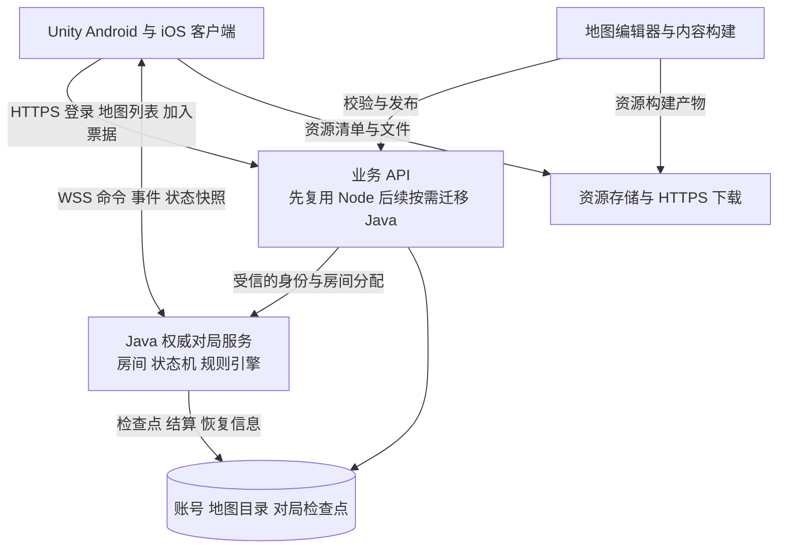

# MineMonopoly Unity 新版架构评估

**任务状态：待定。** 当前优先评估现有 `apps/server` 的 Java 迁移，实施任务见 [Java 服务端迁移任务](Java/README.md)。下文保留已讨论的 Unity 产品需求与架构建议，不纳入本轮迁移排期；本轮也不实施权威对局或方案 C。

评估日期：2026 年 10 月 10 日。源码基线：`4efbbd3`。范围：Unity 移动端独立运行，后续逐步替换现有游戏客户端，不要求与旧客户端同房互通。本文为架构提案，尚无 Unity 工程或联机压测结果。

**新版建议采用 Unity 客户端加服务端权威对局：服务器执行规则并保存状态，Unity 负责输入、界面和表现。** 用户已确定保留地图创作能力、允许升级地图与脚本方案，并要求手机房主退出后服务器继续运行、玩家回来后可以重连。原方案 C 的纯消息转发无法满足这一对局生命周期要求。

沿用本次 Java 选型评估的方向，主方案收敛为 **Unity C# 客户端、Java 权威对局服务、版本化地图与数据规则、服务端重连恢复**。Java 作为技术建议，不代表用户已经确定实现语言；C#/.NET 仍可按团队熟练度作为备选。现有 Node 账号、地图管理与后台 API 可以在 Unity 开发期间继续使用。

已确定的需求是：Unity 独立运行并逐步替换旧客户端；地图创作能力保留，格式与脚本可升级；任意手机后台、锁屏或退出不使整局依赖该手机；玩家回来后恢复原有席位和可操作状态。旧地图转换范围仍需盘点，允许格式升级不等于所有旧脚本都能自动转换。

## 1 新目标如何改变前次结论

| 前次评估的前提 | Unity 新版的前提 | 架构影响 |
| --- | --- | --- |
| 保留 Vue、Three.js 和房主 Worker | 游戏客户端用 Unity 重建 | 保留 PeerJS 协议的价值降低，无须专门实现旧协议互通 |
| TypeScript 前后端共享代码 | 新客户端使用 C# | Node 的共享类型优势缩小，但已有规则和脚本仍有复用价值 |
| 房主设备持续执行规则 | 手机可能切后台、锁屏、切换网络 | 应将在线规则放在服务器，房主只保留房间管理角色 |
| Java 仅转发消息 | 需要完整、可恢复的对局状态 | 增加回合、规则、计时、存档和交互恢复，工作量显著扩大 |
| 地图内容由现有客户端理解 | Unity 要重建资源、界面和规则适配 | 读出地图文件不等于能够运行旧地图 |

Unity 的后台运行开关不能保证手机持续运行游戏：Android 真正进入后台时应用会暂停，iOS 的生命周期由系统管理。因此，仅把 WebRTC 替换成 WebSocket，仍然无法保证手机房主离开应用后对局继续。[Unity 应用后台行为](https://docs.unity3d.com/ScriptReference/Application-runInBackground.html)

客户端房主掉线导致整局暂停或结束不符合已确认需求。房间创建者可以保留管理权限，在线对局生命周期由服务器掌握。

## 2 推荐职责划分

图中按职责划分模块，不要求首版拆成多个微服务。选择 Java 时，API 与对局模块可以放在同一个应用内；复用旧 Node API 时，新增对局服务单独部署。数据库的对局字段由一个模块负责写入，避免不同服务各自修改同一局状态。

| 部分 | 负责内容 | 关键边界 |
| --- | --- | --- |
| Unity 客户端 | 地图呈现、角色动画、触摸输入、音效、弹窗、资源缓存 | 发送操作意图，不自行确认扣款、骰子结果或胜负 |
| 业务 API | 登录、账号、地图目录、内容发布、房间发现与加入凭证 | 不随每条对局消息读写账号数据库 |
| 对局服务 | 回合推进、操作校验、随机结果、卡牌与地产、AI、断线策略 | 每个房间只有一个有效规则执行者，顺序处理改变状态的命令 |
| 状态存储 | 对局检查点、恢复信息、结算记录 | 客户端断线恢复与服务器重启恢复分别设计 |
| 内容管线 | 地图版本、规则包、资源校验与发布 | 每局固定地图及规则版本，进行中的游戏不受发布覆盖影响 |

房主仍可拥有开局、踢人、选图等权限，但不再是规则执行设备。服务器可以在任意玩家断线后按产品规则等待、托管或结束其席位，其余玩家的通信不依赖该手机。

目前骰子结果由 [Worker](../apps/client/src/core/worker/GameProcessWorker.ts)与 [Dice](../apps/client/src/core/worker/class/Dice.ts)生成，客户端再做表现。新版也应保持这种职责分离，无须为骰子视觉动画默认部署完整 Unity 引擎到服务器。

## 3 Java Node.js 与 C# 的重新比较

| 路线 | 适用条件 | 主要投入 | 本项目判断 |
| --- | --- | --- | --- |
| Unity 加 Java 纯消息转发 | 接受手机房主掉线影响全局 | Unity 重建规则，Java 转发与重连 | 不符合已确认的持续对局要求 |
| Unity 加 Java 权威对局 | Java 后端方向，规则允许升级 | 将回合、卡牌、地产、规则及恢复逻辑移到服务端 | 本次主评估方案，职责比原方案 C 更大 |
| Unity 加 C#/.NET 权威对局 | 围绕 Unity 重建玩法，希望共享纯 C# 数据和规则代码 | 移植现有规则，建设独立于 UnityEngine 的领域模块 | 语言备选，适合 C# 团队或后续离线规则复用 |
| Unity 加 TypeScript 权威对局 | 旧 JavaScript 地图脚本兼容优先 | 抽离 Worker 宿主、脚本隔离、存档和新协议 | 保留为旧内容兼容路线，不作为新版的默认依赖 |
| Unity 客户端加 Unity 专用服务端构建 | 权威逻辑确实依赖 Unity 场景、物理或对象同步 | 服务端构建、资源剥离、进程调度、恢复机制 | 现有回合制玩法暂不足以证明必须采用 |

Java 主方案直接规划“Unity 客户端 → Java 权威对局”。原型从官方固定玩法与一项可编辑规则开始，正式版将地图创作能力作为产品范围，不先围绕手机房主建设整套转发服务。

如果没有必须采用 Java 的团队约束，C#/.NET 应加入候选。可将 `Game.Domain` 设计成不依赖 UnityEngine 的普通 C# 模块，供服务器使用，并在需要离线练习或本地校验时由 Unity 复用。在线模式依然由服务器最终裁定；共享代码并不等于相信客户端提交的结果。共享库的目标框架、序列化与 AOT 兼容性需要在实际 Unity 版本验证。

ASP.NET Core 支持 WebSocket；普通 .NET 对局进程不需要启动 Unity 场景。[Microsoft WebSocket 文档](https://learn.microsoft.com/en-us/aspnet/core/fundamentals/websockets?view=aspnetcore-10.0)

若服务端需要 Unity 引擎能力，可再选择专用服务端构建。Unity 官方区分普通无图形模式与针对服务端优化的构建目标，不能把两者视为相同部署形态。[Unity 服务端构建说明](https://docs.unity3d.com/Manual/desktop-headless-mode.html)

后端语言不决定这套拓扑能否成立。Java 与 C# 的工程成本仍受团队熟练度和离线需求影响，不能据此承诺性能排名；地图与消息契约独立于语言，有助于保留后续调整空间。

## 4 现有代码和地图能复用多少

| 现有内容 | Unity 新版的处理方式 |
| --- | --- |
| Express、MySQL、账号与地图管理 | 可通过 HTTPS 继续复用，后续独立决定是否迁移 Java |
| Vue 页面与 Three.js 渲染代码 | 需要用 Unity 重建；布局、交互设计和资源可作为参考 |
| TypeScript 游戏规则 | 选择 Node 时抽离复用；选择 Java 或 C# 时移植，需验证行为一致性 |
| PeerJS 与 DataConnection | 新版不必兼容；旧客户端停止服务前按旧链路维护 |
| 模型、纹理与音频源文件 | 部分可复用，需检查格式、材质、动画、坐标和移动端资源预算 |
| Protobuf 地图外层 | 可实现跨语言解码，但仍需解释内部数据、脚本与资源 |
| 地图编辑器 | 可独立保留现有工具，新增 Unity 导出和内容校验；无需随游戏客户端一起重写 |
| 自定义弹窗、按钮及 UI | Unity 需要对应的 UI 渲染与交互协议，不能直接复用 Vue 组件 |
| IndexedDB 存档 | 新在线架构使用服务端检查点；旧存档导入属于独立兼容需求 |

现有 [GameProcessWorker](../apps/client/src/core/worker/GameProcessWorker.ts) 约 4,592 行，[Room](../apps/client/src/core/monopoly-host/Room.ts) 约 2,687 行，此外还有玩家、地产、卡牌、阶段、修饰器与 AI 类。它们包含脚本回调、定时器、等待玩家输入及动画完成等流程，不能按单个网络模块的规模估算重写成本。

### 4.1 地图文件兼容分为三层

1. **容器层**：解密、解压、Protobuf 字段与资源字节。见 [地图 schema](../packages/utils/protos/game-map-product.proto)、[产物编解码](../packages/utils/protos/product.ts)、[压缩](../packages/utils/compress.ts)和[加密](../packages/utils/crypto/index.ts)。
2. **内容层**：棋盘、路线、模型、材质、角色、音效及界面描述，需要 Unity 的加载与渲染实现。
3. **行为层**：卡牌、阶段、角色初始化和修饰器包含可执行的 TypeScript 或 JavaScript。见 [ChanceCard](../apps/client/src/core/worker/class/ChanceCard.ts)、[GamePhase](../apps/client/src/core/worker/class/GamePhase.ts)与[玩家初始化](../apps/client/src/core/worker/class/Player.ts)。

现有 `.proto` 的 `payload` 本身是字符串，生成 C# 或 Java 的 Protobuf 类只解决外层解码。旧地图即使成功读入，也不代表规则、材质和自定义 UI 已经兼容。

### 4.2 新版规则格式

用户允许升级地图与脚本方案，因此推荐将常见玩法表达为有明确类型和执行语义的数据命令：移动、收付款、地产变更、卡牌效果、条件分支、阶段事件、修饰器和选择弹窗。编辑器将作者的配置或节点图导出成版本化规则包，Java 规则引擎执行，Unity 呈现结果。

现有 [玩家命令](../packages/types/interfaces/game/action-system/player-command-map.ts)已有 `player.money.gain`、`player.walk` 等概念，[地产命令](../packages/types/interfaces/game/action-system/property-command-map.ts)覆盖所有者和等级变化，可以作为能力清单的起点。但原命令中有 IPlayer、IProperty 等运行时对象，跨语言格式需要换成实体 ID、明确的数值和可序列化数据，不能直接搬运 TypeScript 类型。

规则引擎内部命令与玩家网络命令分开定义。例如，玩家只能请求使用自己持有的卡牌，服务端验证后才执行规则包中的加钱动作；客户端不能直接调用内部 `money.gain` 来修改余额。

| 规则能力 | 建议的表示与执行约束 |
| --- | --- |
| 触发与阶段 | 回合开始、到达地块、支付前后等明确事件，规定执行顺序 |
| 数据与条件 | 有类型的变量、实体选择器、条件表达式，数值范围和舍入语义固定 |
| 效果与修饰器 | 引用受支持的命令，明确目标、参数、触发次数和取消行为 |
| 玩家交互 | 产生 interactionId、选项与截止时间，在服务端保存等待状态 |
| 流程控制 | 显式步骤或节点，不依赖无法序列化的脚本闭包；限制步数、嵌套和循环 |
| 随机结果 | 服务器生成并记录结果，恢复和重放时不重新随机 |
| 版本 | 固定 schemaVersion、规则引擎版本、规则包 hash 和所需能力 |

例如“到达收费格 → 计算费用 → 扣款 → 广播结果”由服务器完整执行。需要选择路径时，规则引擎保存当前节点与候选项后等待输入；Unity 重连后重新显示同一个交互，而不是重跑整段脚本。

数据规则不是任意 JavaScript 的完整替代品。正式版需要盘点现有阶段、卡牌、修饰器、自定义 UI 和 AI 相关能力，并用代表地图验证覆盖范围。不能自动转换的旧脚本输出诊断并安排重写，不静默删除效果。高级脚本如仍有必要，应采用单独隔离的扩展运行时及明确 API，另行估算。

现有 [Worker 防护](../apps/client/src/core/worker/security.ts)不能直接作为服务器运行用户脚本的隔离边界。若以后保留脚本扩展，需增加进程或容器权限隔离、资源时限和受控游戏 API；Node 官方明确 `node:vm` 不是安全隔离机制。[Node VM 文档](https://nodejs.org/api/vm.html)

Unity 手机端只需要解析视图数据和资源，不必动态编译作者代码。Unity IL2CPP 的 AOT 与反射约束也应纳入客户端序列化方案验证。[Unity IL2CPP 限制](https://docs.unity3d.com/Manual/scripting-restrictions.html)

## 5 通信与移动端恢复

当前是少人数回合制桌游，推荐先验证 WSS 加明确的命令、事件和状态快照。HTTP 负责登录与资源，长连接只承载小型对局消息。是否使用二进制序列化取决于真实消息大小，首版不因使用 Unity 就默认引入逐帧位置同步。

客户端发送 `RollDice`、`BuyProperty`、`ChoosePath` 等操作，服务端验证角色、回合与版本后，返回骰子结果、资产变化和待处理选择。Unity 按结果播放动画；服务器以明确的等待期限和交互状态推进流程，不无限依赖某台手机发回动画完成通知。

| 协议内容 | 用途 |
| --- | --- |
| 协议、地图与规则版本 | 隔离新旧客户端与不兼容内容，每局固定版本 |
| 房间、玩家与连接代次 | 验证身份，隔离网络切换后的旧连接 |
| commandId 与状态版本 | 去重玩家重试，拒绝已经过期的操作 |
| eventSequence 与 lastAck | 检查事件缺口，决定补发或重新拉取快照 |
| interactionId 与 expiresAt | 恢复选路、弹窗、倒计时等未完成交互 |
| 按玩家生成的视图 | 只下发该玩家有权看到的状态，私有信息不广播 |

移动端重连流程应为：重新建立连接、验证会话、恢复房间身份、获取快照或补齐事件、重建交互、恢复输入。前后台切换与 Wi-Fi/移动网络切换均按可能丢失连接处理；不能依赖退出回调一定执行。

玩家断线后保留其席位和身份，服务器按规则继续其他玩家的流程。轮到离线玩家时，采用有截止时间的等待与默认动作或 AI 托管；具体等待时长和托管策略是房间规则参数。重新上线后在一个明确的操作边界交回控制权，避免真人输入与已开始的 AI 操作同时生效。创建者退出不触发整局关闭。

建议保存的恢复状态包括回合与当前阶段、玩家资产及位置、规则执行步骤和局部变量、待处理交互与截止时间、已产生的随机结果、消息序号和命令去重结果。客户端收到按权限过滤的视图；完整规则执行上下文留在服务器。

客户端断线时，服务器状态仍存活；服务器自身重启则需要持久化恢复。首版可以按回合和关键操作保存检查点，并保存随机结果、未完成交互及结算去重记录。若要求已确认操作在崩溃后不丢失，确认响应前必须完成相应的持久化；仅定时快照允许回退，不能宣称无损恢复。

服务器端按房间顺序执行命令，避免两次买地或使用卡牌并发改变同一状态。多实例时增加房间归属和执行租约；普通连接粘性或加入 Redis 都不会自动保证只有一个有效执行者。

### 5.1 Unity 多人联网组件的适用位置

若选择 Unity 引擎服务端与对象同步，可通过 Unity 主要多人联网包统一管理创建、加入和网络生命周期，避免再建设一套重复的房间成员系统。其接口和网络连接有明确的生命周期边界。[Unity 网络生命周期说明](https://docs.unity.com/en-us/mps-sdk/session-networking)

若选择 Java、Node 或普通 .NET 自定义对局服务，则使用与该服务协议匹配的 Unity 客户端通信适配器。Unity 对象同步协议与普通 WebSocket 业务消息不能仅靠修改连接地址互通；需选定并实现一致的应用协议。

客户端房主方案即使使用现成多人联网工具，也需处理游戏状态迁移。选出新房主不等于已经迁移网络同步状态，更不代表本项目的脚本、倒计时和待回答弹窗可以自动恢复。[Unity 房主迁移说明](https://docs.unity.com/en-us/mps-sdk/session-host-migration)

## 6 地图资源与版本发布

新版建议通过 HTTPS 下载地图和资源，WSS 只发送版本、标识、状态及加载确认。现有经房主传送整张自定义地图的路径无需原样搬迁。

地图发布清单至少区分 `mapSchemaVersion`、`rulesVersion`、资源 hash、文件大小、所需客户端能力和目标平台。规则数据可跨平台共享；Unity 的材质、资源构建与加载方式需要单独验证 Android、iOS 和后续桌面端，不能承诺同一资源包通用。

需要支持未公开地图时，应先上传到带权限的临时存储，再让本房间成员下载；该流程单独定义权限与失效，不把大文件放进对局事件队列。旧地图转换工具应输出兼容性报告，对无法转换的脚本、资源或 UI 明确标记。

## 7 渐进替换与验证范围

建议分成以下可独立验收的阶段：

1. **确定规则能力清单**：按已确认的新规则格式路线，选一个具有代表性的官方地图，固定骰子、购地、收费、卡牌、阶段和交互案例，列出旧脚本需转换或重写的部分。
2. **做一局完整验证**：两个 Unity 客户端连接一个权威对局服务；使用简单画面完成开局、行动、结算和断线重连，验证手机切后台不影响其他玩家。
3. **打通内容管线**：保留地图编辑器，增加新版导出、校验与预览；导入模型、实现资源缓存和自定义交互，验证作者修改规则后确实改变游戏行为。
4. **补齐产品与恢复能力**：账号、房间管理、AI、服务检查点、移动设备性能、长时间运行和故障恢复。
5. **并行运营后切换**：旧客户端使用旧房间池，Unity 使用新房间池；账号可共享，不承诺旧存档自动导入。停止新建旧房间、等进行中对局结束后再退役旧服务。

无需为了最终会退役的旧客户端，先投入完整的 Java 转发适配。只有当旧版近期确有独立的联机改善需求，才将该工作作为单独项目评估。

### 7.1 工作量估算的变化

此前 **12～20 人日**只覆盖旧客户端通信改造，不能作为 Unity 新版预算。新版增加 Unity 客户端、权威规则执行、内容转换与服务端恢复，属于产品迁移。

可先为最小验证安排 **5～10 人日的粗预算**，前提是熟悉 Unity 和所选后端，只做一张示例地图、一项可编辑的数据规则、简化画面、两客户端及基本重连，不包含完整规则语言、任意旧脚本、完整编辑器、服务器无损恢复和应用商店发布。这是用于发现风险的原型预算，不是正式版本工期。

正式版本应按客户端表现、游戏规则、地图工具、旧内容转换、后端服务与设备回归分别估算。地图创作方向已经确定，仍需盘点具体规则能力和可复用美术资源后给出整套产品工期。

### 7.2 原型验收

- 同一 commandId 重发不会重复掷骰、扣款或使用卡牌，过期交互被拒绝。
- 任意一台手机切后台、锁屏或断网后，服务器仍按设定规则推进；回来后恢复正确的操作界面。
- 骰子和资产由服务器裁定，修改客户端显示不能改变权威状态。
- 资源下载不会阻塞游戏命令；资源损坏或版本不兼容可以明确拒绝加入。
- 地图作者修改一项卡牌或地块规则并重新发布，新房间采用新规则，进行中的房间继续使用原版本。
- 规则等待选择时玩家离线，重连恢复同一个 interactionId；超时已被服务器处理的旧选择不能再次提交成功。
- 分开记录服务端处理、网络往返和客户端动画延迟，并在真机观察内存与恢复行为。
- 若包含服务重启恢复，验证检查点、未完成交互、随机结果和结算记录；没有覆盖的恢复能力明确保留为后续范围。

## 8 当前决策建议

需求已收敛为 Unity 独立客户端、保留地图创作且允许格式升级、服务器持续执行对局、玩家可重连。沿用 Java 评估方向，推荐 **Unity 加 Java 权威规则服务，加版本化数据规则和服务端恢复状态**。

首版可由一个 Java 应用承载网络入口、房间状态和规则解释器，按模块分离职责；复用 MySQL 与资源存储。现有 Node API 作为过渡继续运行，是否全部迁移 Java 不影响新对局链路的验证。当前没有必要因选用 Unity 就额外引入 Unity 引擎服务端或多实例消息中间件。

C#/.NET 保留为团队技术选型备选。Java 与 C# 两条路线都遵守相同的地图、协议和恢复模型；语言选择不改变已经确认的规则归属。下一步的最小验证同时覆盖一项可编辑玩法和手机后台重连，验证创作能力与持续对局两个核心目标。
